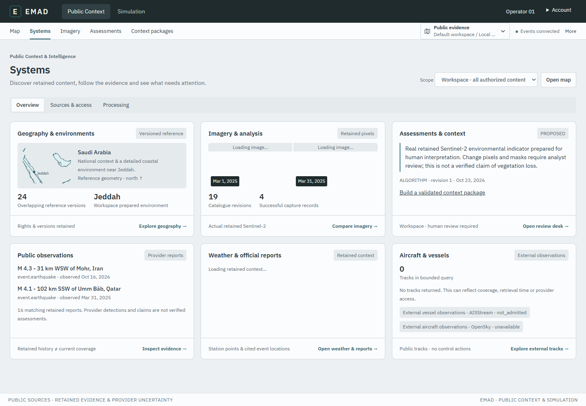
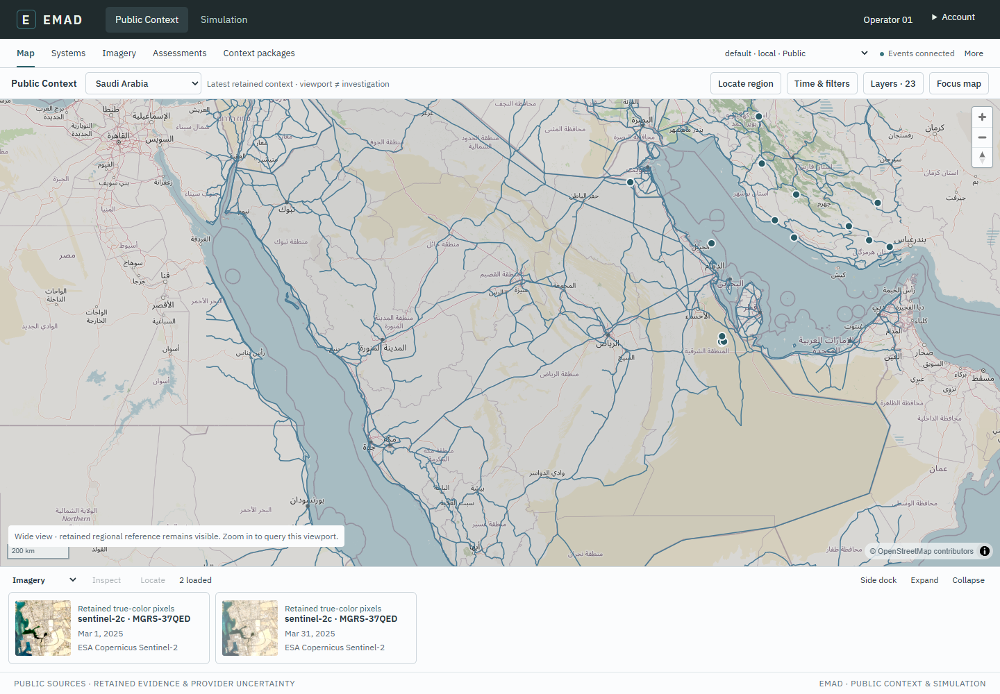

# Application review captures

Captured on 24 October 2026 from the persistent local installation, after the workspace redesign. These are running application screens with retained imagery, reference geometry and validated model bytes. The [capture manifest](capture.json) records browser, dimensions and screenshot hashes.

Open the live [Systems](http://127.0.0.1:5173/systems) and [Map](http://127.0.0.1:5173/map) to review the interactions.

## Systems and clean map

## Focused workspaces

- [Home](home-desktop.png)
- [Imagery comparison](imagery-desktop.png)
- [Retained analysis with its inputs alongside](analysis-desktop.png)
- [Searchable scene catalogue](catalogue-desktop.png)
- [Assessment review](review-desktop.png)
- [Context export](context-desktop.png)
- [Weather evidence](weather-desktop.png)
- [External-track state](tracks-desktop.png)
- [Validated model library](assets-desktop.png)
- [Simulation Studio](studio-desktop.png) and [selected model focus](studio-actor-focus-desktop.png)
- [Operator replay](replay-desktop.png)
- [Source access and retrieval](sources-desktop.png)
- [Map layer inspector](map-layers-desktop.png)
- [Templates and environments](assets-definitions-desktop.png)
- [Asset admission](assets-import-desktop.png)

## Narrow screens

- [Home](home-mobile.png)
- [Systems](systems-mobile.png)
- [Map](map-mobile.png)
- [Imagery](imagery-mobile.png)
- [Analysis](analysis-mobile.png)
- [Catalogue](catalogue-mobile.png)
- [Review](review-mobile.png)
- [Context export](context-mobile.png)
- [Weather evidence](weather-mobile.png)
- [External-track availability](tracks-mobile.png)
- [Model library](assets-mobile.png)
- [Studio](studio-mobile.png)
- [Studio run controls](studio-run-mobile.png)
- [Replay](replay-mobile.png)

See the [implementation and acceptance record](../EMAD_UX_IMPLEMENTATION.md) for verification and the scope of these captures. Source observation/acquisition dates are distinct from screenshot capture time.

The [follow-up review](../EMAD_UX_POLISH_REVIEW.md) explains the concrete defects corrected after the first implementation pass.
