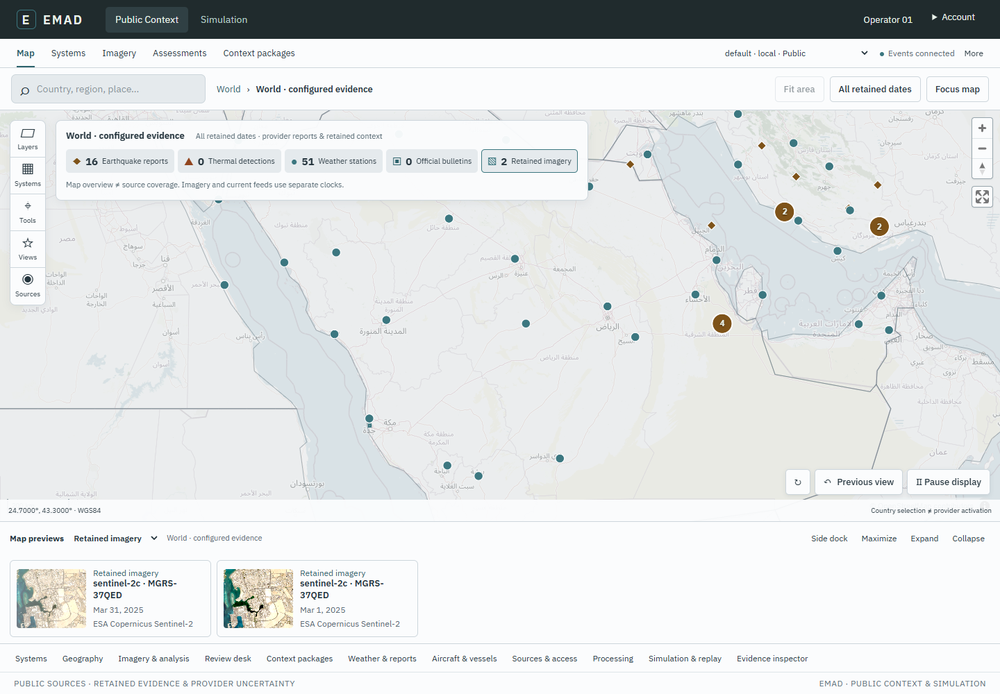
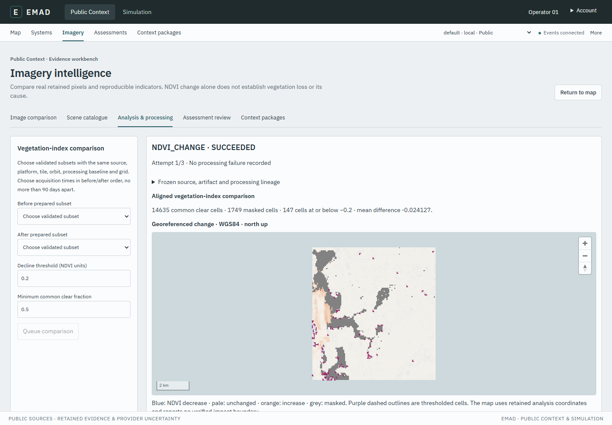
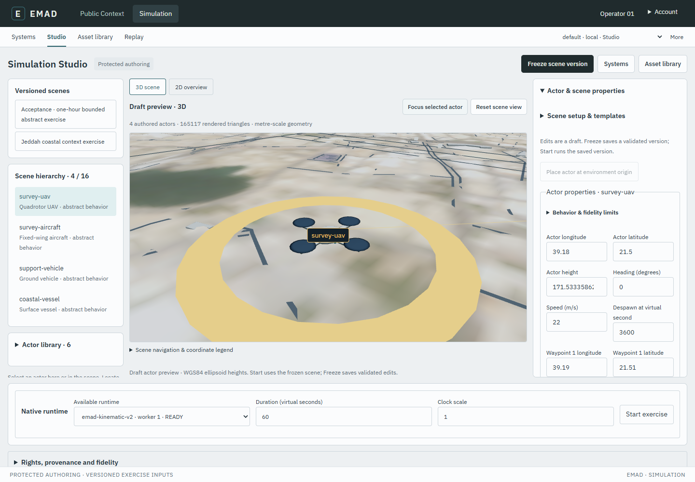

# EMAD delivery recovery acceptance

2026-10-23. This recovery replaces the unconfigured local rollout with persistent Public Context and native exercise workflows. The [original audit](DELIVERY_AUDIT_2026_10_23.md) remains the record of what was missing. The [delivery ledger](RECOVERY_STATUS.json) records implementation, verification, installation and external prerequisites separately for all 33 original task records and nine recovery stages.

**Subsequent OpenSky activation:** The user-supplied Standard OAuth client now completes bounded live retrieval. See the [OpenSky acceptance report](OPENSKY_ACTIVATION.md). References to OpenSky being gated below describe the earlier recovery snapshot; FIRMS and AIS remain externally gated.

**Subsequent FIRMS activation:** The [FIRMS key and live adapter are accepted](FIRMS_ACTIVATION.md). The installed source is backfilling its initial lookback under existing pacing; its first day page was accepted, with complete installed query coverage still pending. AIS is the remaining provider access gate. Earlier gated-source statements below describe the original recovery snapshot.

Open **http://127.0.0.1:5173/** after `task dev`. Use [supported operations](RECOVERY_OPERATIONS.md) for setup, account switching, diagnostics, source activation, shutdown, backup and restore. No database reset, commit or push was performed.

**Subsequent workspace redesign:** The [24 October UX delivery](../design/EMAD_UX_IMPLEMENTATION.md) replaces the earlier interface layouts with the Systems grid, clean map preview dock and focused workbenches. Its own acceptance record and screenshots document the updated application.

## What is installed and visible

Home reports actual content and worker/storage readiness. Public Context displays 24 versioned reference datasets: Saudi boundaries, populated places, coastline and major routes, plus bounded Jeddah roads, buildings, places and elevation. Layers can be combined, queried by PostGIS viewport and paged when the bounded feature budget is reached. Producer attribution, acquisition times, source hashes, revisions and coverage remain inspectable. Source retrieval and retained historical evidence are reported separately.

USGS and station-weather retrieval run persistently; a clearly dated March 2025 USGS capture provides historical evidence. The official GDACS earthquake-bulletin RSS retrieval succeeded with zero retained records in the selected Saudi region. Its earlier HTTP 406 failure remains in retrieval history; the native XML Accept header and audited local pacing reconciliation corrected the cause. Zero regional results do not mean there were no hazards.

The imagery workspace contains actual Sentinel-2 Collection 1 windows from **1 and 31 March 2025**, matching tile/orbit, acquired from separately admitted Earth Search assets. Retained B04/B08/B03/B02/SCL TIFF windows, ETags/range receipts, scale/offset metadata, aligned subsets, true-color images and quality masks are private persistent artifacts. The real comparison has **14,635 common clear cells**, **1,749 masked cells**, **147 cells at or below −0.2 NDVI**, and mean difference **−0.024127**. These are calculated indicators requiring interpretation, not a verified vegetation-loss claim. The map and keyboard-inspectable panels use the retained analysis grid. An isolated restore reproduced the exact result hash from restored inputs.

The real assessment remains **PROPOSED**. A separate **DEVELOPMENT WORKFLOW TEST** assessment was reviewed/published using distinct registered development identities and exported with frozen canonical identity proof. Same-human aliases received 403 for review, publication and rejection. Services cannot perform human review. Historical identity resolution is an append-only sidecar; immutable assessment documents were preserved, and unresolved/invalid historical independence claims cannot support newly approved exports. No claim of review by two actual people is made.

Studio loads the retained Jeddah coastal environment, approximately 8 km × 8 km, with real Copernicus DSM, a March 2025 Sentinel drape, 750 retained road segments and 1,800 bounded building footprints. The manifest pins the input EGM2008 datum, retained PROJ geoid grid, explicit `H + N` conversion to WGS84 ellipsoid heights, transformation version and round-trip validation. This is a surface model with estimated building dimensions, omissions and mixed source dates; it is not surveyed bare-earth terrain. Large parent inputs are retained as hash-verified private object chunks.

Six project-authored recognizable models, dimensions, validation manifests, licensing, templates and two reusable sensor-quality presets are installed. The ready Jeddah exercise has four actors, two abstract synthetic sensors and an exercise-controlled UAV. Start selects an admitted available runtime build and launches queued work in the separate executable. Pause freezes virtual time; synthetic observations and virtual HOLD/RESUME_ROUTE tasking follow it. Authoring and privileged moving-world views remain separate from the operator view.

Operators receive released geography, perceived contacts and their controlled assets' telemetry. The environment contract contains no frozen actors, routes, templates or sensor settings. Unknown contact altitude remains unknown: any projection onto the displayed surface is explicitly a display assumption. Terminal exercises archive automatically. Replay reads retained journals and the released environment version after restart, with play/pause, seeking, speed and event navigation. It never reruns the simulator or issues commands. Evaluator spatial replay requires explicit truth/evaluation access and a recorded purpose; released operator reports contain only selected numeric metrics.

See the [walkthrough video](evidence/recovery/emad-walkthrough.webm) for the analyst/author workflow. The [model library](evidence/recovery/model-library-desktop.png), [operator replay](evidence/recovery/replay-desktop.png), [mobile replay](evidence/recovery/replay-mobile.png) and [privileged evaluation](evidence/recovery/evaluator-spatial.png) are actual installed-browser captures. The last image contains development exercise truth and is explicitly evaluator evidence, not an ordinary operator report.

## Verification and measured limits

The [machine-readable acceptance record](evidence/recovery/ACCEPTANCE.json) ties these results to retained evidence and file hashes. Detailed failure, identity, graphics, virtual-hour and isolated-restore reports are beside it. Private logs, provider receipts and backups remain under ignored `private/local` and `tmp/recovery`.

- Go unit tests/build checks and the full assembled PostGIS/S3 integration suite passed. The final production UI browser compatibility gate passed all 16 cases. The browser regression suite passed 80 cases with 54 intentional duplicate-project/credential-mode skips.
- Three persistent real-backend walkthroughs passed: public imagery through tasking/archive/replay; evaluator-to-operator account isolation; and moving privileged 3D, model previews, keyboard pan, 390px layouts and real WebSocket reconnection. API/WebSocket responses were not mocked in these walkthroughs. The normal development connection reached ready once, reconnected after a deliberate close and retained one application socket. The persistent Vite log contained no reported proxy aborts.
- Repeated setup preserved reference/model/template/preset/scene identities and credential bytes. Supported shutdown preserved database/storage volumes. Original migrations 1–38, the migration script and line-ending policy retained their protected hashes; forward migrations 39–43 are applied.
- Failure rehearsals passed for native worker termination/restart and lease expiry, honest partial archiving, temporary object-storage loss/recovery, expired credentials, interrupted/resumed setup and raster-worker lease recovery. An expired raster lease could not update the recovered job. Existing integration tests cover provider failures, pacing and duplicate retrieval; no live third-party outage was manufactured.
- A four-actor, two-sensor, five-model run completed **3,600 seconds of virtual time in 644.36 wall seconds**, with requested clock scale 20. API acceptance time reduces effective acceleration. It retained 73,259 operator events and 702 truth-journal events, totaling **54,546,436 journal/checkpoint bytes**, excluding shared model/environment artifacts. The 174 measured COP reads had median 16 ms, p95 32 ms and maximum 47 ms, with no recorded read failures. Sampling covered the resumed monitor interval, not the entire run. Browser regressions and an image build ran concurrently. This is not a one-hour wall-clock soak.
- The populated scene was measured in explicitly selected headless Chromium **SwiftShader software rendering** while orbiting and receiving actor snapshots. The graphics report records observed render rate, canvas dimensions and submission times. It is not a maximum GPU benchmark. Hardware was AMD Ryzen 9 7900X, 24 logical CPUs, roughly 31.2 GiB RAM, with NVIDIA GeForce RTX 4070 Ti SUPER and integrated AMD graphics present; software rendering was used for reproducible browser acceptance.
- A coordinated database/object backup was restored into isolated new PostgreSQL/Garage volumes. Every object hash was verified, and the restored API served reference data, captured imagery, all seven pinned models/environment and retained recordings. NDVI was reproduced from restored real inputs. The source installation was not replaced.
- The Linux worker image built and passed non-root/read-only startup checks for asset, imagery and recording queues, native runtime description and raster dependencies. The staging delivery composition validates. This proves packaging; it does not claim an external staging or production deployment.

## Remaining external prerequisites and future scope

FIRMS requires a valid map key. OpenSky requires approved use and, where applicable, OAuth client credentials. AISStream requires approved use/retention and an API key. Their complete bounded paths remain explicitly gated in this installation; no synthetic public aircraft, vessel or fire observations disguise missing access. Their live-provider acceptance cannot be claimed before that access is supplied.

Actual intelligence publication awaits real human interpretation and independent review. Development profiles demonstrate software/account separation only. External redistribution remains governed by the retained source terms; no new distribution permission is inferred.

The agreed runtime limits remain 16 actors, eight models, one hour and admitted synthetic-sample budgets. Advanced physics, calibrated radar, large-world streaming and broader S4 expansion remain future work. The recovered delivery is the agreed bounded installation, not completion of that long-term ambition.
