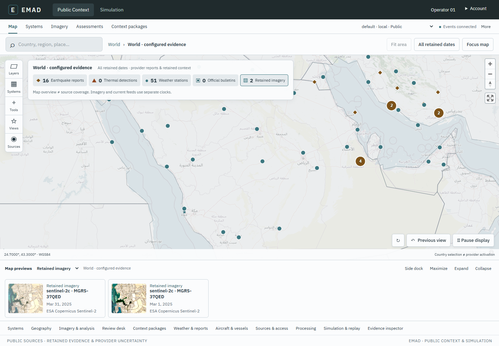
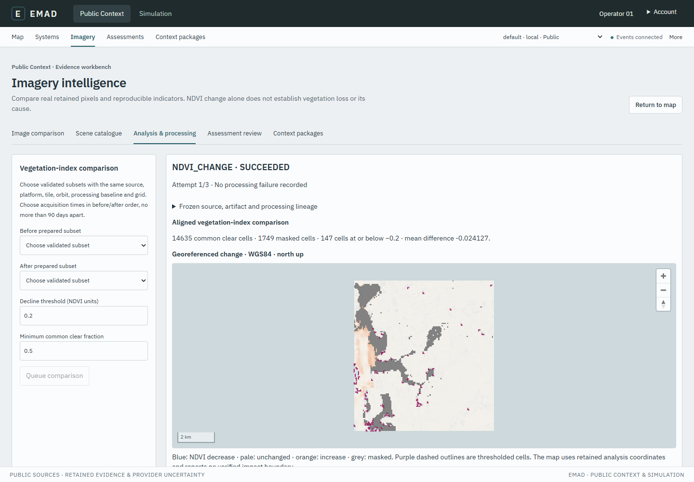
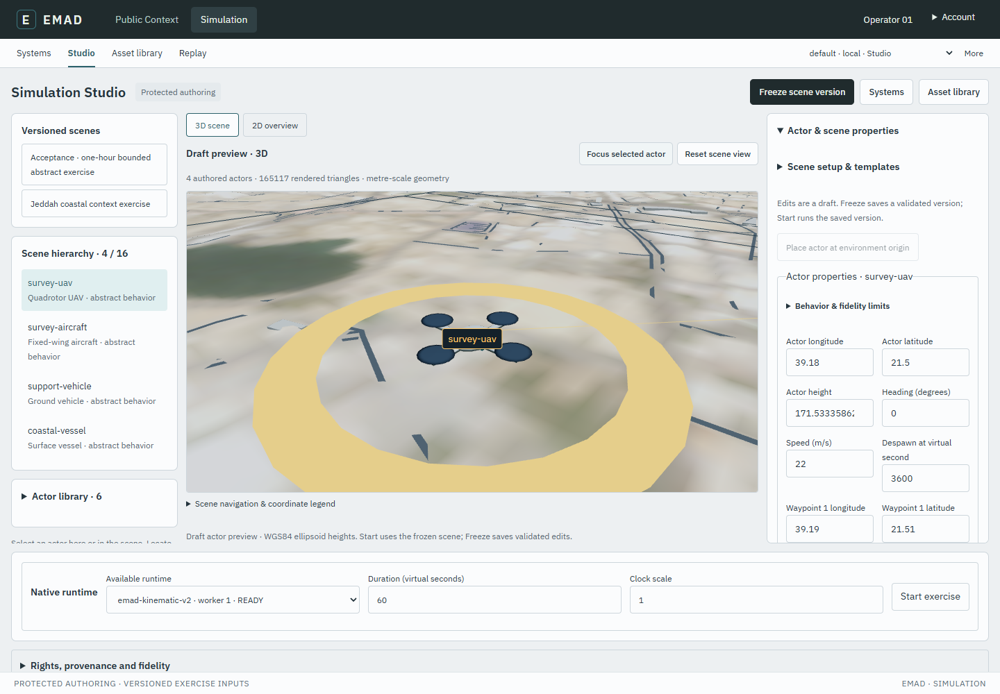

# Historical delivery record: the bounded recovery of 23–24 October 2026

> **Historical record — bounded delivery recovery.** This merges the delivery audit, its recovery acceptance, the review and commit-readiness records, the provider activation snapshots and the asset-licensing record for the pre-map-first snapshot. The current map-first qualification result is in [MAP_FIRST_PRODUCT.md](MAP_FIRST_PRODUCT.md#29-october-2026-product-evaluation). See the [records index](README.md).

## Contents

- [Delivery audit (23 October 2026)](#delivery-audit)
- [Delivery recovery acceptance](#recovery-acceptance)
- [Implementation plan review](#plan-review)
- [Implementation readiness for review](#review-readiness)
- [Commit readiness](#precommit-readiness)
- [FIRMS local activation](#firms-activation)
- [OpenSky local activation](#opensky-activation)
- [Development assets: licensing and limits](#development-assets)

---

## Delivery audit (23 October 2026)

> **Historical record — bounded delivery recovery, 23–24 October 2026.** Retained as traceability history: this audit's counts and findings describe the pre-map-first snapshot. The current map-first qualification result is [MAP_FIRST_PRODUCT_EVALUATION_2026_10_29.md](MAP_FIRST_PRODUCT.md#29-october-2026-product-evaluation). See the [records index](README.md).

**Subsequent recovery:** See [delivery recovery acceptance](#recovery-acceptance) and the [current ledger](RECOVERY_STATUS.json). This audit remains evidence of the earlier failed delivery; its counts describe that earlier snapshot.

**Conclusion: delivery is incomplete. The earlier blanket conclusion that all 32 tasks plus S4.1 were delivered and ready for review was too broad and should not be used as the current product status.**

There is substantial working implementation. The failure was accepting technical profiles and disposable-fixture demonstrations as sufficient evidence of a configured, usable installation. The audit also confirms a real assessment-review correctness defect and a missing real-terrain preparation/handoff. Changing permissions or adding a Home page does not close those gaps.

This report covers the original 32 tasks, the user-selected S4.1 increment, the two authoritative v2 proposals, the current dirty working tree, and the observed local development database. Earlier Phases 0–21 remain the historical documented baseline; this audit does not recertify that entire older product.

### 1. What can be quantified honestly

- **33 task records reviewed:** corresponding implementation/artifact evidence was located for all 33. This does not mean every requirement is correct or delivered.
- **8 technical foundation/contract/decision records evidenced:** F0.1–F0.5, S0.1–S0.2 and S1.2. This category includes mathematical contracts and a renderer decision, not eight populated user workflows.
- **1 partial default rollout:** F0.6. The recent Home/module navigation fix is present, but the installed account/resources are still legacy-only.
- **24 capability records have profile evidence but are not activated in the local installation.** These include data-facing public and native exercise features. P2.3 and P3.3 additionally share a confirmed review correctness defect.
- **0 of the 2 authoritative end-to-end demonstrations are installed persistently.** The automated profiles are real evidence, but their temporary data is not user content.
- **45 of 53 tables introduced in migrations 19–38 are empty.** The eight populated new tables contain workspace/environment/scope, principal/credential/grant and authorization support.
- **12 findings and 9 recovery packages** are recorded below. Findings overlap; adding their counts is not a measure of independent implementation effort.

No defensible overall completion percentage follows from these counts. A coordinate-library task, an identity migration and a real imagery workflow have different scope and effort. Table population is evidence of activation, not a code-completion metric.

### 2. Observed persistent installation

Database snapshot: 2026-10-23T00:36:20+03:00 (Asia/Riyadh), also retained as 2026-10-22T21:36:20Z UTC. Queries ran with PostgreSQL default_transaction_read_only=on as the local administrative role; row-level filtering therefore did not hide content from the inventory. Schema migration **38** is applied.

- One registered operator, one human principal and one principal grant.
- Three data scopes, all default/local/EXERCISE_OBSERVATION: legacy and two older scenario runs.
- No PUBLIC_EVIDENCE, EXERCISE_INPUT or EXERCISE_TRUTH scope; no source-bound connector or native worker principal.
- No public admissions/evidence/events/reference features, imagery scenes/jobs/artifacts, approved context packages, models/templates/environments/scenes, native runs/exercises, recordings/evaluations/released reports or sensor presets.
- Existing exercise content includes four synthetic sources, 41 observations, one track, two classifications, two geofences, one alert and two scenario runs. These records were preserved; they do not represent the new public/native delivery.

The full non-secret table counts, resource tuples and grant metadata are retained in [the machine-readable audit](../../docs/implementation/evidence/DELIVERY_AUDIT_2026_10_23.json). No credential hashes or bearer tokens are included.

### 3. What actually exists and should be preserved

The work is not empty scaffolding. Implemented paths include persisted scoped identities and RLS; service authorization; provenance and revision-aware ingestion; native provider adapters; real reference sample files; immutable packages; raster preparation and NDVI jobs; assessment revisions; model validation; a Three.js authoring viewport; an independent native kinematic runtime; synthetic perception and virtual tasking; and archive/replay/evaluation code. Recent builds and fixture-backed integration/browser checks exercise many of these paths.

The retained Natural Earth/NOAA subsets are real prepared reference data. Copernicus files contain real recorded catalogue metadata, not retained satellite raster bands. USGS has documented historical live acceptance in a disposable database. FIRMS/moving/report fixtures do not establish live activation. The shipped abstract-wing model is one triangle; the ground tile is two triangles. Their declarations are honest test geometry, not a meaningful aircraft/environment library.

#### Fresh behavioral checks

1. **Prepared terrain probe:** both retained artifact hashes matched. Passing elevation.json to the actual scene loader at the declared Jeddah frame failed with an unresolved EGM2008-to-WGS84-ellipsoid conversion. Passing the whole places.json failed the 10 km radius. The audit did not relabel heights or disable validation.
2. **Independent-review probe:** the existing P2 integration test was rerun on disposable PostGIS/S3 through a Go overlay that added only a diagnostic log. It successfully published using source-reviewer and p2-independent-reviewer, both registered to operator-01. The source guard checks principal IDs; it does not enforce distinct registered humans. The test passed while confirming the defect.
3. The preceding startup follow-up passed 80 browser regressions, 16 real-backend browser checks and the production build. Those results are reused as recent evidence; they do not close the above installation/correctness gaps.

### 4. Findings, impact and required correction

#### D01 — Technical profile completion was reported as product delivery

**Class:** Acceptance and reporting. **Delivery priority:** Blocking. **Affected tasks:** F0.6, P1.6, P2.4, S1.3, S3.3.

The architecture requires two end-to-end user demonstrations. Neither exists in the persistent installation. Plan/readiness reports treated fixture-based milestone passes as completion of the product delivery. The recent Home/navigation repair does not supply data, services or these demonstrations.

**Impact:** Migrate/restart instructions reasonably led the user to expect usable new product pillars; normal installation acceptance was not performed.

**Required:** Replace blanket completion with implementation/profile/installed states and require persistent user journeys before closing delivery.

**Evidence:** [EMAD_ARCHITECTURE_AND_DIRECTION_v2.md](../../EMAD_ARCHITECTURE_AND_DIRECTION_v2.md) (line 414); [EMAD_ARCHITECTURE_AND_DIRECTION_v2.md](../../EMAD_ARCHITECTURE_AND_DIRECTION_v2.md) (line 418); [EMAD_IMPLEMENTATION_PLAN_v2.md](../../EMAD_IMPLEMENTATION_PLAN_v2.md) (line 5).

#### D02 — No public, authoring, evaluator or worker access setup is installed

**Class:** Unfinished activation. **Delivery priority:** Blocking. **Affected tasks:** F0.2, F0.6, P1.1, S2.1, S3.3.

The inventory contains one human principal and one wildcard legacy exercise grant. All three scopes are EXERCISE_OBSERVATION. There is no public/input/truth scope or connector/runtime/worker principal. The restriction itself is intentional; the explicit rollout is missing.

**Impact:** Normal accounts cannot use new resources and required workers cannot authenticate with their intended scoped identities.

**Required:** Provide explicit trusted role/service setup, including distinct registered humans for independent review; verify effective access without implicit privilege expansion.

**Evidence:** [internal/platform/access/store.go](../../internal/platform/access/store.go) (line 46); [internal/platform/access/catalog.go](../../internal/platform/access/catalog.go) (line 13).

#### D03 — Prepared and test data was never installed as persistent product content

**Class:** Unfinished activation. **Delivery priority:** Blocking. **Affected tasks:** P1.1, P1.3, P1.4, P1.5, P1.6, P2.1, P3.3, S1.1, S1.3.

Of 53 tables added by migrations 19–38, 45 are empty. The eight populated new tables are identity/scope/authorization support. New public, reference, imagery, context, model/template/scene, native exercise, recording/evaluation and preset content is absent. Older synthetic exercise records remain.

**Impact:** The new UI has no persistent content to show. Migrations and menu changes cannot populate it.

**Required:** Perform idempotent provenance-preserving admissions/imports/captures in the intended persistent workspace and provide a visible import receipt.

**Evidence:** [internal/integration/harness_test.go](../../internal/integration/harness_test.go) (line 65); [scripts/data/import_reference_sample.ps1](../../scripts/data/import_reference_sample.ps1) (line 2).

#### D04 — Supplied stacks do not package new storage and workers

**Class:** Missing deployment integration. **Delivery priority:** Blocking. **Affected tasks:** P1.1, P2.1, P2.2, S1.1, S2.1, S3.2.

Development Compose starts PostgreSQL. Staging packages the API/UI/database and observability, but no private artifact store or EMAD worker profiles. The server image contains the API and goose. Separate connector, imagery, model-import, runtime and recording executables require manual credentials/configuration/launch.

**Impact:** Rebuilding API/UI does not activate retrieval, processing, simulation or archiving. Unknown external S3 setup is not assumed absent; no operational handoff was verified.

**Required:** Deliver a supported persistent local profile with private blobs and supervised/on-demand workers, preserving separate identities and exact-build admission.

**Evidence:** [deployments/docker-compose.yml](../../deployments/docker-compose.yml) (line 4); [deployments/staging/docker-compose.yml](../../deployments/staging/docker-compose.yml) (line 41); [deployments/Dockerfile.server](../../deployments/Dockerfile.server) (line 25); [apps/emad-runtime/main.go](../../apps/emad-runtime/main.go) (line 43).

#### D05 — The environmental intelligence proof uses synthetic pixels

**Class:** Missing real-data acceptance. **Delivery priority:** High. **Affected tasks:** P2.1, P2.2, P2.3, P2.4.

Real STAC catalogue metadata is retained and NDVI computation/preparation code exists. The end-to-end integration constructs 4×4 synthetic spectral arrays. No real retained raster pair, installed environmental result or real-data reviewed assessment demonstrates the promised analyst workflow. Preparation starts from already retained local bands.

**Impact:** The numerical and lineage mechanics are tested for their declared fixture, but a useful real-image intelligence demonstration remains undelivered.

**Required:** Complete one permitted real-raster pair through masks/comparability, processing, canonical independent review and approved context export.

**Evidence:** [internal/integration/imagery_test.go](../../internal/integration/imagery_test.go) (line 115); [scripts/data/prepare_imagery_subset.py](../../scripts/data/prepare_imagery_subset.py) (line 3); [testdata/imagery/retrieval.json](../../testdata/imagery/retrieval.json) (line 5).

#### D06 — Prepared real geography fails the current Studio handoff

**Class:** Missing transformation implementation. **Delivery priority:** High. **Affected tasks:** P1.3, S0.2, S0.3, P2.4, S1.3.

Fresh probes passed the unmodified retained files to GeometryFor at the documented Jeddah frame. NOAA elevation fails the unresolved EGM2008 datum; the full places subset fails the 10 km radius. Export retains whole artifacts without clipping. The acceptance scene used synthetic 3×3 ellipsoidal relief and one manually subset reference point.

**Impact:** The central real geography → approved package → scene path is incomplete. Correct rejection safeguards should stay; the explicit derivative preparation is missing.

**Required:** Add versioned AOI subsetting and validated datum/height conversion, or choose a compatible permitted source; retain original bytes and transformation provenance.

**Evidence:** [internal/simscene/domain.go](../../internal/simscene/domain.go) (line 149); [internal/simscene/domain.go](../../internal/simscene/domain.go) (line 78); [internal/contextpackage/service.go](../../internal/contextpackage/service.go) (line 100); [internal/integration/studio_runtime_test.go](../../internal/integration/studio_runtime_test.go) (line 38).

#### D07 — Geographic scene content is far narrower than the proposed world-building inputs

**Class:** Unclosed architecture coverage. **Delivery priority:** Scope gap. **Affected tasks:** P1.3, P2.4, S1.3.

Retained reference content is two generalized populated-place points plus coarse elevation. No OSM road/building import pipeline was located in reviewed paths. Studio skips non-point vectors and retains imagery/analysis as lineage rather than rendering imagery on terrain.

**Impact:** This supports a tiny coordinate proof, not a rich geographic environment. This is a proposal-coverage limitation; a full city engine was not a required initial S1 implementation.

**Required:** Explicitly bound the next useful geographic region/layers/omissions. A displayed basemap must not be described as ingested or scene-ready GIS.

**Evidence:** [EMAD_FINAL_DATA_STRATEGY_v2.md](../../EMAD_FINAL_DATA_STRATEGY_v2.md) (line 62); [internal/simscene/domain.go](../../internal/simscene/domain.go) (line 202); [internal/simscene/domain.go](../../internal/simscene/domain.go) (line 225).

#### D08 — 3D authoring is static; live 3D movement/playback and spatial truth review are absent

**Class:** Unclosed product capability. **Delivery priority:** Scope gap. **Affected tasks:** S1.3, S2.3, S3.2, S3.3.

SceneViewport consumes a frozen scene and positions actors from authored input, with no runtime-snapshot input. Runtime lifecycle and the 2D Exercise COP are separate. Recording playback uses a longitude/latitude SVG plot; evaluation offers metrics/numeric release rather than spatial truth overlays. The static model profile rejects animations/skins.

**Impact:** The kinematic runtime genuinely exists, but the visible moving 3D experience does not. Static S1/abstract S2 acceptance cannot stand for the full long-term simulator.

**Required:** Scope a role-safe live/recorded display adapter, usable starter assets and spatial after-action views. Preserve the distinction between authoring, operator perception and privileged truth.

**Evidence:** [apps/operator-ui/src/features/simulation/SceneViewport.tsx](../../apps/operator-ui/src/features/simulation/SceneViewport.tsx) (line 43); [apps/operator-ui/src/features/simulation/SceneViewport.tsx](../../apps/operator-ui/src/features/simulation/SceneViewport.tsx) (line 36); [apps/operator-ui/src/routes/recordings.tsx](../../apps/operator-ui/src/routes/recordings.tsx) (line 38); [apps/emad-asset-validator/validate.mjs](../../apps/emad-asset-validator/validate.mjs) (line 47).

#### D09 — Independent assessment review checks principal alias rather than registered human

**Class:** Confirmed correctness defect. **Delivery priority:** Blocking. **Affected tasks:** P2.3, P3.3.

AuthorID stores principal ID and Act rejects only equal principal IDs. Multiple human principals can share operator_id. The existing test creates source-reviewer and p2-independent-reviewer for operator-01 and successfully reviews/publishes. A fresh disposable PostGIS/S3 rerun confirmed this; the overlay added only a diagnostic log.

**Impact:** A second authorized principal of the same registered operator passes the independent-human guard. Appropriate provisioned permissions are required; no ability for an ordinary user to create aliases is asserted.

**Required:** Use canonical registered human identity for authorship/review independence while preserving principal/credential audit identity; deny same-human aliases and accept genuinely different registered humans.

**Evidence:** [internal/assessments/review.go](../../internal/assessments/review.go) (line 156); [internal/assessments/review.go](../../internal/assessments/review.go) (line 268); [internal/integration/imagery_test.go](../../internal/integration/imagery_test.go) (line 317); [internal/platform/access/provision.go](../../internal/platform/access/provision.go) (line 100).

#### D10 — Several live integrations remain conditional or unactivated

**Class:** External prerequisites. **Delivery priority:** Conditional. **Affected tasks:** P1.5, P3.2, P3.3.

FIRMS live verification is key-gated. Repository rollout documents leave OpenSky/AISStream access/keys/rights unresolved. METAR/GDACS here have fixture/protocol acceptance. USGS has a documented historical live smoke and should not be misreported as never tested.

**Impact:** Disabled coverage is a delivery limitation, but no external key/permission should be invented or synthetic evidence represented as live data.

**Required:** Track and close each source's prerequisites separately, recheck terms at activation and perform bounded persistent acceptance. This audit does not establish current legal/provider eligibility.

**Evidence:** [internal/integration/firms_live_test.go](../../internal/integration/firms_live_test.go) (line 15); [internal/integration/usgs_live_test.go](../../internal/integration/usgs_live_test.go) (line 10); [docs/implementation/HISTORICAL_DELIVERY.md](../../docs/implementation/HISTORICAL_DELIVERY.md#p2-4-p3-1-2) (line 40).

#### D11 — Database health/backups do not cover the new dependency chain

**Class:** Missing operational handoff. **Delivery priority:** High. **Affected tasks:** P1.1, P2.1, P2.2, S2.1, S3.2.

The default health handler pings PostgreSQL only. Feature/job health logic exists, but API health does not establish configured sources, storage or running workers. Bundled backups/restores handle PostgreSQL while imagery/models/recordings require external blobs. Tiny profile measurements do not establish representative long-running operation.

**Impact:** A green connection can coexist with unusable pillars; database-only restore cannot recover missing dependent blobs.

**Required:** Deliver feature-readiness diagnostics, paired database/blob recovery rehearsal and a bounded representative operational workload.

**Evidence:** [internal/app/app.go](../../internal/app/app.go) (line 526); [scripts/ops/backup.sh](../../scripts/ops/backup.sh) (line 20); [docs/implementation/HISTORICAL_DELIVERY.md](../../docs/implementation/HISTORICAL_DELIVERY.md#p2-1-3) (line 25).

#### D12 — Normal setup and complete workflows remain fragmented

**Class:** Missing user-facing handoff. **Delivery priority:** High. **Affected tasks:** F0.6, P1.1, P2.3, P2.4, S1.3, S2.1, S3.3.

The old default launch hid major new routes. Recent Home/navigation and a single optional analyst setup guide repair discovery, but full setup still spans admissions, service credentials, storage, imports, runtime build hashes/attachment and separate reviewer/evaluator identities. No integrated persistent setup/acceptance path was verified.

**Impact:** Following migrate → dev:api → dev:web still does not deliver the intended analyst-to-exercise experience without additional specialist setup.

**Required:** Provide guided setup or an explicit trusted bootstrap command, persistent starter content and a normal-user walkthrough; a general-purpose IAM administration product is not necessary.

**Evidence:** [docs/implementation/MAP_FIRST_OPERATIONS.md](../../docs/implementation/MAP_FIRST_OPERATIONS.md#historical-startup) (line 31); [apps/operator-ui/src/routes/simulation-studio.tsx](../../apps/operator-ui/src/routes/simulation-studio.tsx) (line 54); [apps/operator-ui/src/routes/home.tsx](../../apps/operator-ui/src/routes/home.tsx) (line 53).

### 5. Task-by-task reassessment

The classifications below describe delivery evidence, not weighted completion or estimated effort. The complete original bullet requirements and original completion text are preserved per task in the JSON ledger. A source/test path is traceability evidence, not automatic proof that its assertions are sufficient.

#### F0.1 — Verify the baseline and publish the migration inventory

**Current delivery class:** Technical foundation evidenced.

**Implemented evidence:** Baseline inventory, migration audit and executed verification records.

**Missing/limited:** Historical checks did not establish a populated two-pillar installation.

**Delivery exit:** Retain the baseline and add persistent installation acceptance.

**Traceability:** [active plan](../../EMAD_IMPLEMENTATION_PLAN_v2.md) (captured task line 160); [implementation/artifact](../../docs/implementation/HISTORICAL_DELIVERY.md#f0-1); [verification/profile evidence](../../docs/implementation/F0_1_INVENTORY.json).

#### F0.2 — Define principals, resource context, and contract vocabulary

**Current delivery class:** Technical foundation evidenced.

**Implemented evidence:** Human/service principals, resource grants, credential lifecycle and administrator CLI.

**Missing/limited:** Only one legacy human principal and one exercise grant are installed; no analyst/author/evaluator/worker identities.

**Delivery exit:** Explicitly provision scoped roles and service identities; distinct registered humans are required for independent review.

**Traceability:** [active plan](../../EMAD_IMPLEMENTATION_PLAN_v2.md) (captured task line 172); [implementation/artifact](../../internal/platform/access/store.go); [verification/profile evidence](../../internal/integration/provisioning_cli_test.go).

#### F0.3 — Add ownership persistence and backfill safely

**Current delivery class:** Technical foundation evidenced.

**Implemented evidence:** Ownership persistence, backfill/quarantine, referential checks and forced RLS; local schema reaches 38.

**Missing/limited:** Only three legacy exercise scopes exist. Schema migration does not import new content.

**Delivery exit:** Preserve migration history and original evidence; create authorized public/input resources explicitly.

**Traceability:** [active plan](../../EMAD_IMPLEMENTATION_PLAN_v2.md) (captured task line 184); [implementation/artifact](../../db/migrations/00020_resource_ownership.sql); [verification/profile evidence](../../internal/integration/ownership_migration_test.go).

#### F0.4 — Enforce boundaries in application services and queries

**Current delivery class:** Technical foundation evidenced.

**Implemented evidence:** Scoped service/query paths and cross-resource negative cases.

**Missing/limited:** No activated local public/native workflow demonstrates these boundaries to the user.

**Delivery exit:** Keep boundaries enabled while validating installed workflows; do not grant implicit global access.

**Traceability:** [active plan](../../EMAD_IMPLEMENTATION_PLAN_v2.md) (captured task line 197); [implementation/artifact](../../internal/platform/db/scoped.go); [verification/profile evidence](../../internal/integration/scope_test.go).

#### F0.5 — Separate realtime delivery and protect metadata

**Current delivery class:** Technical foundation evidenced.

**Implemented evidence:** Scoped versioned streaming, payload filtering, revocation and reconnect behavior.

**Missing/limited:** A healthy socket is not evidence that public/native producers are running. A cancelled development handshake was repaired separately.

**Delivery exit:** Demonstrate installed producers, reconnect and revocation with current permissions.

**Traceability:** [active plan](../../EMAD_IMPLEMENTATION_PLAN_v2.md) (captured task line 209); [implementation/artifact](../../internal/realtime/hub.go); [verification/profile evidence](../../internal/integration/realtime_boundaries_test.go).

#### F0.6 — Separate workspaces and close the compatibility gate

**Current delivery class:** Partial default rollout.

**Implemented evidence:** Workspace/cache isolation and Public/Exercise selection; Home/direct module links were added after the complaint.

**Missing/limited:** The default account still lacks public and authoring scopes. Earlier new routes were not discoverable.

**Delivery exit:** Verify ordinary startup with explicitly configured accounts and visible, populated workflows.

**Traceability:** [active plan](../../EMAD_IMPLEMENTATION_PLAN_v2.md) (captured task line 221); [implementation/artifact](../../apps/operator-ui/src/components/WorkspaceProvider.tsx); [verification/profile evidence](../../apps/operator-ui/tests/e2e/product-entry.spec.ts).

#### P1.1 — Source admission, provenance, and connector execution

**Current delivery class:** Profile proof exists; not activated locally.

**Implemented evidence:** Admissions, immutable evidence, provenance, quotas/backoff/checkpoints and bounded execution.

**Missing/limited:** No admission, connector state, connector run or public evidence is installed.

**Delivery exit:** Activate one reviewed source/AOI and its service worker; verify durable evidence, health and recovery.

**Traceability:** [active plan](../../EMAD_IMPLEMENTATION_PLAN_v2.md) (captured task line 242); [implementation/artifact](../../internal/publicingest/service.go); [verification/profile evidence](../../internal/integration/public_ingestion_test.go).

#### P1.2 — Separate point events, areas, and moving observations

**Current delivery class:** Profile proof exists; not activated locally.

**Implemented evidence:** Point/event/area/moving semantics, revision projections and spatial rules.

**Missing/limited:** Public event tables are empty; current public behavior is evidenced through fixtures.

**Delivery exit:** Verify persisted reports, corrections/withdrawals, spatial effects and zero fabricated tracks.

**Traceability:** [active plan](../../EMAD_IMPLEMENTATION_PLAN_v2.md) (captured task line 255); [implementation/artifact](../../internal/publicevents/projector.go); [verification/profile evidence](../../internal/integration/public_events_test.go).

#### P1.3 — Reference GIS and terrain catalogue

**Current delivery class:** Profile proof exists; not activated locally.

**Implemented evidence:** Reference APIs and retained Natural Earth/NOAA samples with rights, coordinates and hashes.

**Missing/limited:** No reference data is imported. Prepared EGM2008 terrain needs conversion/cropping for Studio; no OSM road/building import pipeline was located.

**Delivery exit:** Import the real reference region and derive a separately versioned scene-ready subset with valid datum/extent.

**Traceability:** [active plan](../../EMAD_IMPLEMENTATION_PLAN_v2.md) (captured task line 268); [implementation/artifact](../../internal/reference/service.go); [verification/profile evidence](../../internal/integration/reference_test.go).

#### P1.4 — USGS event integration

**Current delivery class:** Profile proof exists; not activated locally.

**Implemented evidence:** Native USGS adapter and a documented historical five-report live smoke.

**Missing/limited:** The live smoke used disposable PostGIS, not the persistent developer workspace.

**Delivery exit:** Admit and capture bounded USGS reports in the persistent installation and inspect their revisions/originals.

**Traceability:** [active plan](../../EMAD_IMPLEMENTATION_PLAN_v2.md) (captured task line 280); [implementation/artifact](../../internal/publicingest/usgs.go); [verification/profile evidence](../../internal/integration/usgs_live_test.go).

#### P1.5 — FIRMS thermal detection integration

**Current delivery class:** Profile proof exists; not activated locally.

**Implemented evidence:** Bounded NOAA-20 VIIRS retrieval, CSV provenance and time/quality semantics.

**Missing/limited:** No installed FIRMS source/data; keyed live acceptance remains conditional.

**Delivery exit:** Obtain authorized configuration/key, activate one product and retain honest detection/coverage semantics.

**Traceability:** [active plan](../../EMAD_IMPLEMENTATION_PLAN_v2.md) (captured task line 291); [implementation/artifact](../../internal/publicingest/firms.go); [verification/profile evidence](../../internal/integration/firms_live_test.go).

#### P1.6 — Public evidence drill-down and historical view

**Current delivery class:** Profile proof exists; not activated locally.

**Implemented evidence:** Public filters, source originals/revisions, bookmarks and historical time semantics.

**Missing/limited:** There is no installed public evidence to inspect.

**Delivery exit:** Exercise the ordinary UI on retained reports, including outages, originals and history.

**Traceability:** [active plan](../../EMAD_IMPLEMENTATION_PLAN_v2.md) (captured task line 302); [implementation/artifact](../../apps/operator-ui/src/features/public-context/PublicContextPanel.tsx); [verification/profile evidence](../../apps/operator-ui/tests/integration/public-context.spec.ts).

#### S0.1 — Scenario versions, runs, and explicit time

**Current delivery class:** Technical foundation evidenced.

**Implemented evidence:** Frozen scenario/run/clock contracts and deterministic lifecycle tests.

**Missing/limited:** No new simulation version/native run is retained locally; old legacy runs are not the new demonstration.

**Delivery exit:** Retain and execute an installed frozen version with declared seed/build/clock and pause/restart behavior.

**Traceability:** [active plan](../../EMAD_IMPLEMENTATION_PLAN_v2.md) (captured task line 320); [implementation/artifact](../../internal/scenarios/frozen.go); [verification/profile evidence](../../internal/integration/simulation_foundations_test.go).

#### S0.2 — Coordinate and fidelity contracts

**Current delivery class:** Technical foundation evidenced.

**Implemented evidence:** WGS84/ECEF/ENU transforms, axis/unit/fidelity checks and unsupported-datum rejection.

**Missing/limited:** A real EGM2008-to-ellipsoid terrain conversion is absent; rejection is correct.

**Delivery exit:** Preserve the contract and add a validated, versioned transformation for the selected real terrain.

**Traceability:** [active plan](../../EMAD_IMPLEMENTATION_PLAN_v2.md) (captured task line 333); [implementation/artifact](../../internal/simulation/spatial.go); [verification/profile evidence](../../internal/simulation/spatial_test.go).

#### S0.3 — Context package manifest and integrity

**Current delivery class:** Profile proof exists; not activated locally.

**Implemented evidence:** Immutable manifests, retained bytes, rights, hashes and offline validation.

**Missing/limited:** No installed package. A smaller selected AOI retains whole artifacts rather than clipping them.

**Delivery exit:** Retain an approved real context package and explicitly derive crop/transform/omission metadata.

**Traceability:** [active plan](../../EMAD_IMPLEMENTATION_PLAN_v2.md) (captured task line 344); [implementation/artifact](../../internal/contextpackage/service.go); [verification/profile evidence](../../internal/integration/context_export_test.go).

#### S0.4 — Existing runner adapter and minimal synthetic ingress

**Current delivery class:** Profile proof exists; not activated locally.

**Implemented evidence:** Existing runner adapter, synthetic ingress and headless frozen-context fixtures.

**Missing/limited:** No installed context-backed exercise demonstrates this path.

**Delivery exit:** Run retained context with feeds disabled, opaque observation identities and protected mappings.

**Traceability:** [active plan](../../EMAD_IMPLEMENTATION_PLAN_v2.md) (captured task line 356); [implementation/artifact](../../internal/exerciseingest/service.go); [verification/profile evidence](../../internal/integration/headless_context_test.go).

#### P2.1 — Artifact storage and imagery catalogue

**Current delivery class:** Profile proof exists; not activated locally.

**Implemented evidence:** Private S3 artifacts, STAC metadata and bounded scene discovery.

**Missing/limited:** No installed imagery scene/preparation/artifact. Real catalogue metadata is not downloaded imagery; supplied stacks omit blob storage.

**Delivery exit:** Configure private blobs and retain two eligible scenes with permitted raster inputs.

**Traceability:** [active plan](../../EMAD_IMPLEMENTATION_PLAN_v2.md) (captured task line 375); [implementation/artifact](../../internal/imagery/scenes.go); [verification/profile evidence](../../internal/integration/imagery_test.go).

#### P2.2 — Reproducible environmental analysis

**Current delivery class:** Profile proof exists; not activated locally.

**Implemented evidence:** Deterministic raster preparation and asynchronous NDVI with comparability/mask/retry checks.

**Missing/limited:** End-to-end acceptance uses synthetic spectral arrays; no real pair/result is installed. Preparation starts from already retained local bands.

**Delivery exit:** Demonstrate one licensed real-raster comparison with pinned inputs, declared limitations and repeatable worker output.

**Traceability:** [active plan](../../EMAD_IMPLEMENTATION_PLAN_v2.md) (captured task line 386); [implementation/artifact](../../internal/imageryanalysis/ndvi.go); [verification/profile evidence](../../scripts/data/prepare_imagery_subset.py).

#### P2.3 — Reviewable assessments and intelligence workspace

**Current delivery class:** Profile proof exists; not activated locally.

**Implemented evidence:** Assessment proposal/revision/review/publish flows and imagery comparison UI.

**Missing/limited:** Confirmed defect: two principals of the same registered operator can review and publish that human's proposal. No local reviewed content exists.

**Delivery exit:** Enforce independence by canonical registered human identity; deny same-human aliases and accept genuinely different humans.

**Traceability:** [active plan](../../EMAD_IMPLEMENTATION_PLAN_v2.md) (captured task line 398); [implementation/artifact](../../internal/assessments/review.go); [verification/profile evidence](../../internal/integration/imagery_test.go).

#### P2.4 — Approved public-to-simulation export

**Current delivery class:** Profile proof exists; not activated locally.

**Implemented evidence:** Preview/approval, frozen export, rights checks and offline consumption.

**Missing/limited:** No installed preview/package. Retaining imagery/vector lineage does not render it into a 3D environment.

**Delivery exit:** Export real approved evidence/context and disclose exactly what renders, remains a reference or requires conversion.

**Traceability:** [active plan](../../EMAD_IMPLEMENTATION_PLAN_v2.md) (captured task line 410); [implementation/artifact](../../internal/contextpackage/service.go); [verification/profile evidence](../../internal/integration/context_export_test.go).

#### P3.1 — External moving track projection

**Current delivery class:** Profile proof exists; not activated locally.

**Implemented evidence:** External hypotheses, history/associations, late/jump/gap handling and observational-only identity.

**Missing/limited:** No public moving segments or associations are installed.

**Delivery exit:** Populate a permitted bounded capture and verify freshness/history without control authority.

**Traceability:** [active plan](../../EMAD_IMPLEMENTATION_PLAN_v2.md) (captured task line 429); [implementation/artifact](../../internal/externaltracks/projector.go); [verification/profile evidence](../../internal/integration/moving_test.go).

#### P3.2 — One ADS-B provider and AISStream

**Current delivery class:** Profile proof exists; not activated locally.

**Implemented evidence:** OpenSky/AISStream adapters with protocol/fixture/budget tests.

**Missing/limited:** No live integration is installed; documented agreement/key/rights prerequisites remain unresolved.

**Delivery exit:** Close provider prerequisites and conduct bounded persistent live acceptance; label blocked integrations explicitly.

**Traceability:** [active plan](../../EMAD_IMPLEMENTATION_PLAN_v2.md) (captured task line 438); [implementation/artifact](../../internal/publicingest/opensky.go); [verification/profile evidence](../../docs/implementation/HISTORICAL_DELIVERY.md#p2-4-p3-1-2).

#### P3.3 — Weather context and selected reports

**Current delivery class:** Profile proof exists; not activated locally.

**Implemented evidence:** Selected METAR/GDACS natural-hazard pilot, provenance/history and report assessment routes.

**Missing/limited:** No station/report data is installed; review shares the principal-alias independence defect.

**Delivery exit:** Activate the admitted pilot and fix canonical human review before accepting reviewed report delivery.

**Traceability:** [active plan](../../EMAD_IMPLEMENTATION_PLAN_v2.md) (captured task line 447); [implementation/artifact](../../internal/publiccontext/service.go); [verification/profile evidence](../../internal/integration/weather_reports_test.go).

#### S1.1 — Model and environment asset registry

**Current delivery class:** Profile proof exists; not activated locally.

**Implemented evidence:** Immutable model registry, independent bounded glTF validation and separate templates/environments.

**Missing/limited:** No model/template/environment is installed. Samples are tiny abstract meshes; animations/skins are rejected by the static profile.

**Delivery exit:** Import a useful permitted starter set through normal validation and declare its visual/fidelity limitations.

**Traceability:** [active plan](../../EMAD_IMPLEMENTATION_PLAN_v2.md) (captured task line 465); [implementation/artifact](../../internal/modelassets/service.go); [verification/profile evidence](../../apps/emad-asset-validator/validate.mjs).

#### S1.2 — Engine evaluation

**Current delivery class:** Technical foundation evidenced.

**Implemented evidence:** Measured Three.js/Babylon comparison and scoped initial renderer decision.

**Missing/limited:** Benchmark contains 13 triangles/four draws with synthetic terrain; it cannot establish advanced terrain/physics scale.

**Delivery exit:** Retain the initial decision; re-evaluate representative workloads before larger simulation claims.

**Traceability:** [active plan](../../EMAD_IMPLEMENTATION_PLAN_v2.md) (captured task line 474); [implementation/artifact](../../docs/implementation/HISTORICAL_DELIVERY.md#s1-2); [verification/profile evidence](../../apps/operator-ui/scripts/evaluate-engines.mjs).

#### S1.3 — First georeferenced scene and Studio shell

**Current delivery class:** Profile proof exists; not activated locally.

**Implemented evidence:** Frozen scenes, static georeferenced viewport, placement/properties and 2D alternative.

**Missing/limited:** No installed scene. Acceptance substituted synthetic relief/one point; unmodified prepared real files fail the loader.

**Delivery exit:** Resolve real datum/cropping derivatives and make a retained starter scene reachable through normal navigation.

**Traceability:** [active plan](../../EMAD_IMPLEMENTATION_PLAN_v2.md) (captured task line 483); [implementation/artifact](../../internal/simscene/domain.go); [verification/profile evidence](../../internal/integration/studio_runtime_test.go).

#### S2.1 — Runtime lifecycle and actor behavior

**Current delivery class:** Profile proof exists; not activated locally.

**Implemented evidence:** Independent native kinematic executable, broker/lifecycle, leases/build admission and protected truth.

**Missing/limited:** No native run/service identity is installed. Queueing in UI does not launch/attach the separate process.

**Delivery exit:** Provide a trusted on-demand launch/attach path and demonstrate installed lifecycle/clock/failure behavior.

**Traceability:** [active plan](../../EMAD_IMPLEMENTATION_PLAN_v2.md) (captured task line 501); [implementation/artifact](../../internal/simruntime/broker.go); [verification/profile evidence](../../apps/emad-runtime/main.go).

#### S2.2 — Synthetic sensor adapters

**Current delivery class:** Profile proof exists; not activated locally.

**Implemented evidence:** Deterministic abstract sensing with sample/drop/delay/noise settings and controlled telemetry.

**Missing/limited:** No installed native perception run. Scheduled abstract observers do not establish calibrated physical sensing.

**Delivery exit:** Demonstrate configured misses/delays in an installed exercise and preserve truth/perception separation.

**Traceability:** [active plan](../../EMAD_IMPLEMENTATION_PLAN_v2.md) (captured task line 510); [implementation/artifact](../../internal/simruntime/sensors.go); [verification/profile evidence](../../internal/integration/native_perception_test.go).

#### S2.3 — Exercise ingestion and operational picture

**Current delivery class:** Profile proof exists; not activated locally.

**Implemented evidence:** Durable scoped native gateway and exercise read-model projections.

**Missing/limited:** No installed native exercise/projection. Studio is not connected to runtime snapshots for live 3D movement.

**Delivery exit:** Show accepted native synthetic observations in the installed COP, with duplicate/reconnect/cancellation behavior.

**Traceability:** [active plan](../../EMAD_IMPLEMENTATION_PLAN_v2.md) (captured task line 519); [implementation/artifact](../../internal/simruntime/projection.go); [verification/profile evidence](../../internal/integration/native_gateway_test.go).

#### S3.1 — Exercise-controlled workflows

**Current delivery class:** Profile proof exists; not activated locally.

**Implemented evidence:** Run-bound virtual assets/tasking, ACK/outcomes/idempotency and existing operational audit.

**Missing/limited:** No installed native controlled asset/task dispatch; old legacy fixtures are a different path.

**Delivery exit:** Issue an authorized virtual task, observe a simulated outcome and retain correlated audit.

**Traceability:** [active plan](../../EMAD_IMPLEMENTATION_PLAN_v2.md) (captured task line 538); [implementation/artifact](../../internal/nativeexercise/tasks.go); [verification/profile evidence](../../internal/integration/native_perception_test.go).

#### S3.2 — Recording and replay

**Current delivery class:** Profile proof exists; not activated locally.

**Implemented evidence:** Durable operator/truth journals, private archives, checkpoints and read-only historical frames.

**Missing/limited:** No installed recording/archive/worker. User replay is a 2D SVG frame plot rather than animated 3D replay.

**Delivery exit:** Archive/recover an installed run and replay it without side effects; state the 2D/3D scope explicitly.

**Traceability:** [active plan](../../EMAD_IMPLEMENTATION_PLAN_v2.md) (captured task line 548); [implementation/artifact](../../internal/recordings/service.go); [verification/profile evidence](../../internal/integration/recordings_test.go).

#### S3.3 — After-action evaluation

**Current delivery class:** Profile proof exists; not activated locally.

**Implemented evidence:** Versioned perception/workflow metrics, audited evaluator reads and selective numeric release.

**Missing/limited:** No installed evaluation/report/evaluator. Broader spatial truth-overlay UX is absent.

**Delivery exit:** Evaluate the retained run using a separately granted evaluator and release only intended summaries.

**Traceability:** [active plan](../../EMAD_IMPLEMENTATION_PLAN_v2.md) (captured task line 560); [implementation/artifact](../../internal/recordings/evaluation.go); [verification/profile evidence](../../apps/operator-ui/src/routes/recordings.tsx).

#### S4.1 — Reusable sensor-quality presets

**Current delivery class:** Profile proof exists; not activated locally.

**Implemented evidence:** Immutable reusable sensor-quality presets pinned into frozen scenes.

**Missing/limited:** No installed preset. This one selected increment does not complete the open-ended S4 roadmap.

**Delivery exit:** Create/reuse presets in installed scenes while keeping future S4 expansion explicitly open.

**Traceability:** [active plan](../../EMAD_IMPLEMENTATION_PLAN_v2.md) (captured task line 590); [implementation/artifact](../../internal/simscene/presets.go); [verification/profile evidence](../../docs/implementation/HISTORICAL_DELIVERY.md#s3-2-s3-3-s4-1).

### 6. Reassessing milestone claims

Previous M0–M6 profile passes are historical test results. They must not be silently promoted into installed product acceptance. This audit does not assert that all seven finite test profiles failed.

- **M0 — Safe foundation:** technical evidence: Substantial isolation/compatibility implementation and negative-test evidence. Installed outcome: Default rollout has only legacy exercise access.
- **M1 — Public evidence workspace:** technical evidence: Reference/event/FIRMS fixture checks and historical USGS live smoke. Installed outcome: No installed public scope, admissions, reference imports or public evidence.
- **M2 — Simulation-ready inputs:** technical evidence: Frozen package/time/coordinates/headless profile evidence. Installed outcome: No installed package/version; real terrain is not scene-ready.
- **M3 — Intelligence demonstration:** technical evidence: Recorded catalogue and synthetic spectral workflow. Installed outcome: No real-raster demonstration; canonical independent-human review is defective.
- **M4 — 3D scene proof:** technical evidence: Tiny static scene with synthetic relief. Installed outcome: No installed scene; retained real inputs fail the loader.
- **M5 — Perception-driven exercise:** technical evidence: Native abstract runtime/sensor/gateway integration tests. Installed outcome: No installed native run or worker identity; no runtime-driven 3D viewer.
- **M6 — Integrated exercise demonstration:** technical evidence: Synthetic tasking, archives, replay and metric flows. Installed outcome: No installed archive/evaluation/report or persistent Demonstration B.

Demonstration A still needs real retained imagery/evidence, a reproducible analysis and genuinely independent human review through the persistent UI. Demonstration B still needs a usable retained real-context scene, launched native exercise, permitted task/outcome, archive/replay and separately granted evaluation in that installation. The static/abstract profiles are valid intermediate engineering steps.

### 7. Recovery sequence before declaring delivery complete

These are proposed acceptance packages, not a claim that nine equal-sized coding tasks will finish the product. Preserve the existing implementation; prioritize handoff/integration and the confirmed correctness defect. R4 is a publication correctness blocker and can proceed alongside setup. Provider-gated work remains explicitly conditional.

#### R1 — Correct completion states and acceptance

**Addresses:** D01, D12.

Separate implementation, fixture/profile and persistent delivery; expose unresolved guarantees.

**Exit evidence:** No blanket completion claim; all blocked/incomplete outcomes are explicit.

#### R2 — Supported deployment and explicit role setup

**Addresses:** D02, D04, D11, D12.

Persistent private blobs, scoped roles, distinct humans, worker launch and runtime-build admission.

**Exit evidence:** A clean supported setup reaches feature readiness without permissive grants.

#### R3 — Persist a usable Public Context region

**Addresses:** D03, D10.

Import real reference data and activate reviewed bounded USGS/FIRMS captures when authorized.

**Exit evidence:** Normal UI exposes retained reports/revisions/provenance and survives restart.

#### R4 — Fix canonical review independence

**Addresses:** D09.

Use stable registered human identity; retain principal audit identity; test aliases and different humans.

**Exit evidence:** Same-human aliases cannot review/publish; genuinely different registered humans can.

#### R5 — Complete real imagery Demonstration A

**Addresses:** D05, D03.

Retain a permitted real raster pair, process it reproducibly, independently review and approve export.

**Exit evidence:** A real-data intelligence workflow works in the persistent installation.

#### R6 — Complete real context-to-scene preparation

**Addresses:** D06, D07.

Derive AOI/height datum/transform/layers while retaining source and omissions.

**Exit evidence:** Actual selected real terrain loads; synthetic substitution cannot pass that acceptance.

#### R7 — Deliver a usable native 3D exercise entry

**Addresses:** D03, D08, D12.

Install starter assets/environment/scene; coordinate trusted launch/attach; scope role-safe moving 3D display.

**Exit evidence:** An author starts an installed exercise and viewers see only their declared permitted state.

#### R8 — Finish persistent archive and evaluation handoff

**Addresses:** D03, D08, D11.

Run recording, retain/recover blobs, use a separate evaluator and deliberately release reports; scope spatial/3D review explicitly.

**Exit evidence:** Demonstration B completes task/outcome/replay/evaluation and survives restart.

#### R9 — Verify recovery, budgets and normal-user operation

**Addresses:** D01, D11, D12.

Rehearse database+blob restore and bounded realistic workload/outage/restart scenarios.

**Exit evidence:** A normal-user walkthrough and receipts prove both pillars independently and together.

### 8. What is legitimately future work

High-fidelity aircraft/UAV/vessel dynamics, physically validated radar/sensors, a broad animated asset library, large-world streaming/3D Tiles, federation, GPU clusters and specialist physics were explicitly deferred or conditional. Real hardware and engagement control are outside the approved roadmap. They are not being counted as missing implementations from the original 32-task scope.

The architecture permits an initial deterministic environmental baseline rather than mandatory AI, a web viewport rather than an immediate Unreal/Godot/Unity project, and separate on-demand executables rather than continuously running expensive services. The Three.js renderer decision itself is not the delivery failure. The failure is the gap between bounded technical evidence, unclosed proposal capabilities and the broad completion statements.

### 9. Audit limits and reproducibility

- This is a task-by-task delivery audit of the dirty working tree, targeted source paths, recent evidence and the observed persistent installation. It does not certify every line of code or the absence of all defects.
- The preceding follow-up executed 80 browser regressions and 16 real-backend browser checks. Those recent results are reused, not rerun wholesale; they prove their cases rather than installation activation.
- The review-alias path was freshly rerun with a Go overlay adding one diagnostic log. Original production/test source was unchanged; the green test confirmed the wrong independence assumption.
- The terrain probes used original retained bytes and the unmodified loader; both source artifact hashes match. No source datum was relabeled to make the probes pass.
- No local application data, access grants, source configuration, applied migration, provider activation, commit or push was changed by the audit.
- Unknown external S3 configuration and current provider permissions/keys were not inspected or revalidated. Bundled-profile omissions and database contents are observed facts.
- High-fidelity aircraft dynamics, physical radar, broad model libraries, federation, GPU clusters and real hardware were explicitly future/deferred/out of scope and are not counted as missed initial tasks.
- Mandatory ML/LLM automation, Kafka/Kubernetes and a particular heavyweight engine were not requirements. A deterministic baseline and a Three.js initial viewport remain compatible with the v2 direction.

Evidence contains 80 reviewed source/artifact fingerprints, captured task requirements, exact read-only table counts, original file-loader errors and the same-human review diagnostic. Raw probe/build/browser logs remain ignored under tmp/delivery-audit-2026-10-23 and tmp/runtime-review. No runtime implementation, user data, grants or migrations were modified by the audit.

**Current decision:** keep the useful technical work, withdraw the blanket product-completion claim, fix canonical review identity, and complete persistent acceptance of both demonstrations. No further S4 expansion should be used to substitute for that handoff.

### 10. Corrections and artifact verification

The active implementation plan, README, full-plan review and precommit record now explicitly withdraw the broad delivery conclusion and link this audit. Original per-task profile claims are retained as historical evidence; the new ledger is the current delivery reassessment. The review-identity defect and the implementation/integration gaps are open; no runtime fix was applied during this analysis.

All 33 task records, 80 source/verification paths, anchored evidence and report links were checked. The interactive canvas type-checks against the installed SDK declarations; its native host rendering was not independently exercised. All 38 applied migrations, the migration script and line-ending policy retain their protected hashes. Staging and commit history remain unchanged.

## Delivery recovery acceptance

> **Historical record — bounded delivery recovery, 23–24 October 2026.** Retained as traceability history for the pre-map-first snapshot. The current map-first qualification result is [MAP_FIRST_PRODUCT_EVALUATION_2026_10_29.md](MAP_FIRST_PRODUCT.md#29-october-2026-product-evaluation). See the [records index](README.md).

2026-10-23. This recovery replaces the unconfigured local rollout with persistent Public Context and native exercise workflows. The [original audit](#delivery-audit) remains the record of what was missing. The [delivery ledger](RECOVERY_STATUS.json) records implementation, verification, installation and external prerequisites separately for all 33 original task records and nine recovery stages.

**Subsequent OpenSky activation:** The user-supplied Standard OAuth client now completes bounded live retrieval. See the [OpenSky acceptance report](#opensky-activation). References to OpenSky being gated below describe the earlier recovery snapshot; FIRMS and AIS remain externally gated.

**Subsequent FIRMS activation:** The [FIRMS key and live adapter are accepted](#firms-activation). The installed source is backfilling its initial lookback under existing pacing; its first day page was accepted, with complete installed query coverage still pending. AIS is the remaining provider access gate. Earlier gated-source statements below describe the original recovery snapshot.

Open **http://127.0.0.1:5173/** after `task dev`. Use [supported operations](MAP_FIRST_OPERATIONS.md#historical-recovery-operations) for setup, account switching, diagnostics, source activation, shutdown, backup and restore. No database reset, commit or push was performed.

**Subsequent workspace redesign:** The [24 October UX delivery](../design/EMAD_UX_IMPLEMENTATION.md) replaces the earlier interface layouts with the Systems grid, clean map preview dock and focused workbenches. Its own acceptance record and screenshots document the updated application.

### What is installed and visible

Home reports actual content and worker/storage readiness. Public Context displays 24 versioned reference datasets: Saudi boundaries, populated places, coastline and major routes, plus bounded Jeddah roads, buildings, places and elevation. Layers can be combined, queried by PostGIS viewport and paged when the bounded feature budget is reached. Producer attribution, acquisition times, source hashes, revisions and coverage remain inspectable. Source retrieval and retained historical evidence are reported separately.

USGS and station-weather retrieval run persistently; a clearly dated March 2025 USGS capture provides historical evidence. The official GDACS earthquake-bulletin RSS retrieval succeeded with zero retained records in the selected Saudi region. Its earlier HTTP 406 failure remains in retrieval history; the native XML Accept header and audited local pacing reconciliation corrected the cause. Zero regional results do not mean there were no hazards.

The imagery workspace contains actual Sentinel-2 Collection 1 windows from **1 and 31 March 2025**, matching tile/orbit, acquired from separately admitted Earth Search assets. Retained B04/B08/B03/B02/SCL TIFF windows, ETags/range receipts, scale/offset metadata, aligned subsets, true-color images and quality masks are private persistent artifacts. The real comparison has **14,635 common clear cells**, **1,749 masked cells**, **147 cells at or below −0.2 NDVI**, and mean difference **−0.024127**. These are calculated indicators requiring interpretation, not a verified vegetation-loss claim. The map and keyboard-inspectable panels use the retained analysis grid. An isolated restore reproduced the exact result hash from restored inputs.

The real assessment remains **PROPOSED**. A separate **DEVELOPMENT WORKFLOW TEST** assessment was reviewed/published using distinct registered development identities and exported with frozen canonical identity proof. Same-human aliases received 403 for review, publication and rejection. Services cannot perform human review. Historical identity resolution is an append-only sidecar; immutable assessment documents were preserved, and unresolved/invalid historical independence claims cannot support newly approved exports. No claim of review by two actual people is made.

Studio loads the retained Jeddah coastal environment, approximately 8 km × 8 km, with real Copernicus DSM, a March 2025 Sentinel drape, 750 retained road segments and 1,800 bounded building footprints. The manifest pins the input EGM2008 datum, retained PROJ geoid grid, explicit `H + N` conversion to WGS84 ellipsoid heights, transformation version and round-trip validation. This is a surface model with estimated building dimensions, omissions and mixed source dates; it is not surveyed bare-earth terrain. Large parent inputs are retained as hash-verified private object chunks.

Six project-authored recognizable models, dimensions, validation manifests, licensing, templates and two reusable sensor-quality presets are installed. The ready Jeddah exercise has four actors, two abstract synthetic sensors and an exercise-controlled UAV. Start selects an admitted available runtime build and launches queued work in the separate executable. Pause freezes virtual time; synthetic observations and virtual HOLD/RESUME_ROUTE tasking follow it. Authoring and privileged moving-world views remain separate from the operator view.

Operators receive released geography, perceived contacts and their controlled assets' telemetry. The environment contract contains no frozen actors, routes, templates or sensor settings. Unknown contact altitude remains unknown: any projection onto the displayed surface is explicitly a display assumption. Terminal exercises archive automatically. Replay reads retained journals and the released environment version after restart, with play/pause, seeking, speed and event navigation. It never reruns the simulator or issues commands. Evaluator spatial replay requires explicit truth/evaluation access and a recorded purpose; released operator reports contain only selected numeric metrics.

See the [walkthrough video](evidence/recovery/emad-walkthrough.webm) for the analyst/author workflow. The [model library](evidence/recovery/model-library-desktop.png), [operator replay](evidence/recovery/replay-desktop.png), [mobile replay](evidence/recovery/replay-mobile.png) and [privileged evaluation](evidence/recovery/evaluator-spatial.png) are actual installed-browser captures. The last image contains development exercise truth and is explicitly evaluator evidence, not an ordinary operator report.

### Verification and measured limits

The [machine-readable acceptance record](evidence/recovery/ACCEPTANCE.json) ties these results to retained evidence and file hashes. Detailed failure, identity, graphics, virtual-hour and isolated-restore reports are beside it. Private logs, provider receipts and backups remain under ignored `private/local` and `tmp/recovery`.

- Go unit tests/build checks and the full assembled PostGIS/S3 integration suite passed. The final production UI browser compatibility gate passed all 16 cases. The browser regression suite passed 80 cases with 54 intentional duplicate-project/credential-mode skips.
- Three persistent real-backend walkthroughs passed: public imagery through tasking/archive/replay; evaluator-to-operator account isolation; and moving privileged 3D, model previews, keyboard pan, 390px layouts and real WebSocket reconnection. API/WebSocket responses were not mocked in these walkthroughs. The normal development connection reached ready once, reconnected after a deliberate close and retained one application socket. The persistent Vite log contained no reported proxy aborts.
- Repeated setup preserved reference/model/template/preset/scene identities and credential bytes. Supported shutdown preserved database/storage volumes. Original migrations 1–38, the migration script and line-ending policy retained their protected hashes; forward migrations 39–43 are applied.
- Failure rehearsals passed for native worker termination/restart and lease expiry, honest partial archiving, temporary object-storage loss/recovery, expired credentials, interrupted/resumed setup and raster-worker lease recovery. An expired raster lease could not update the recovered job. Existing integration tests cover provider failures, pacing and duplicate retrieval; no live third-party outage was manufactured.
- A four-actor, two-sensor, five-model run completed **3,600 seconds of virtual time in 644.36 wall seconds**, with requested clock scale 20. API acceptance time reduces effective acceleration. It retained 73,259 operator events and 702 truth-journal events, totaling **54,546,436 journal/checkpoint bytes**, excluding shared model/environment artifacts. The 174 measured COP reads had median 16 ms, p95 32 ms and maximum 47 ms, with no recorded read failures. Sampling covered the resumed monitor interval, not the entire run. Browser regressions and an image build ran concurrently. This is not a one-hour wall-clock soak.
- The populated scene was measured in explicitly selected headless Chromium **SwiftShader software rendering** while orbiting and receiving actor snapshots. The graphics report records observed render rate, canvas dimensions and submission times. It is not a maximum GPU benchmark. Hardware was AMD Ryzen 9 7900X, 24 logical CPUs, roughly 31.2 GiB RAM, with NVIDIA GeForce RTX 4070 Ti SUPER and integrated AMD graphics present; software rendering was used for reproducible browser acceptance.
- A coordinated database/object backup was restored into isolated new PostgreSQL/Garage volumes. Every object hash was verified, and the restored API served reference data, captured imagery, all seven pinned models/environment and retained recordings. NDVI was reproduced from restored real inputs. The source installation was not replaced.
- The Linux worker image built and passed non-root/read-only startup checks for asset, imagery and recording queues, native runtime description and raster dependencies. The staging delivery composition validates. This proves packaging; it does not claim an external staging or production deployment.

### Remaining external prerequisites and future scope

FIRMS requires a valid map key. OpenSky requires approved use and, where applicable, OAuth client credentials. AISStream requires approved use/retention and an API key. Their complete bounded paths remain explicitly gated in this installation; no synthetic public aircraft, vessel or fire observations disguise missing access. Their live-provider acceptance cannot be claimed before that access is supplied.

Actual intelligence publication awaits real human interpretation and independent review. Development profiles demonstrate software/account separation only. External redistribution remains governed by the retained source terms; no new distribution permission is inferred.

The agreed runtime limits remain 16 actors, eight models, one hour and admitted synthetic-sample budgets. Advanced physics, calibrated radar, large-world streaming and broader S4 expansion remain future work. The recovered delivery is the agreed bounded installation, not completion of that long-term ambition.

## Implementation plan review

> **Historical record — bounded delivery recovery, 23–24 October 2026.** Retained as traceability history for the pre-map-first snapshot. Its delivery conclusion was superseded by the delivery audit. The current map-first qualification result is [MAP_FIRST_PRODUCT_EVALUATION_2026_10_29.md](MAP_FIRST_PRODUCT.md#29-october-2026-product-evaluation). See the [records index](README.md).

**Recovery follow-up — 2026-10-23:** The [persistent recovery acceptance](#recovery-acceptance) and [delivery ledger](RECOVERY_STATUS.json) record the bounded installation, canonical review correction, real imagery/geography, exercises, replay and restore evidence. Restricted sources and actual human review retain explicit gates. The review below is historical evidence for its own source snapshot.

**Delivery conclusion superseded, 2026-10-23:** The [delivery audit](#delivery-audit) found unactivated persistent workflows, an incomplete real-terrain handoff, and a confirmed same-human principal-alias defect in assessment review. The checks below remain historical evidence for their finite cases; their broad product-readiness conclusion is withdrawn.

Reviewed 2026-10-22 against `EMAD_ARCHITECTURE_AND_DIRECTION_v2.md`, `EMAD_FINAL_DATA_STRATEGY_v2.md` and all 32 F0–S3 tasks, plus the selected S4.1 increment. This covers task traceability, the current working tree's domain and integration paths, contracts, UI behavior, operating instructions and verification evidence. Earlier delivery reports remain historical records of their own versions and fixtures.

The delivered scope follows the two-pillar direction. Public evidence and external track hypotheses remain distinct from exercise actors and controllable assets. Simulation authoring, ordinary perception and evaluator truth have separate authorization paths. Existing infrastructure is reused; physics, raster processing, asset validation and archive construction stay outside synchronous API execution. Three.js is the evaluated first viewport adapter; it does not establish specialist physics fidelity or a universal engine choice.

### Findings fixed in this review

1. **Live authorization checks stopped after the first refresh.** A fresh identity context lost its refresh callback, so a later check could use cached grants. `access.Refresh` now retains the live callback. Unit coverage and actual credential revocation during recording artifact retrieval verify the second check reaches current identity state.
2. **Database failure looked like a rejected credential.** Identity lookup converted every query error to unauthorized, which made workers treat an outage as revocation. Only a missing/inactive credential now produces that result; infrastructure failures remain internal errors and can follow the worker's bounded retry policy. Error responses still conceal database details.
3. **Recorded output could finish after access or retention expired.** Frame, event, checkpoint and evaluation reads now recheck current authority, the exact resource and the archive's read window before returning output and recording the successful read. Post-fetch revocation tests cover frame/events/checkpoint, and a retention-change test covers replay. Failure returns an error response without the archived body.
4. **Evaluation sums depended on map order.** Sorting the final metric names did not stabilize floating-point position-error reduction. Published samples now reduce in sorted identity order. Repeated evaluation over deliberately non-associative floating-point inputs verifies identical serialized reports. Metric definitions remain evaluation v2; existing immutable reports are not rewritten.
5. **Moving-track filters drifted from browser history.** The AOI field now follows URL changes on back/forward navigation, with an assembled-backend browser regression.
6. **Missing cloud cover displayed with a percent sign.** Unknown scene cloud cover now displays as unknown, without suggesting a measurement.
7. **Staging validation failed in Windows Git Bash.** Native host mount paths and container paths are now handled separately. The existing Compose, Prometheus configuration/rules, Alloy and Loki checks pass on the actual Windows host. Temporary validation secrets are removed by their explicit filenames.

8. **The mobile header clipped controls and navigation.** Small screens now keep complete status, identity/help controls and a separate navigation row. The role remains readable in the identity menu. Real-backend mobile assertions check control bounds and role access.

Current status links were also added to the historical architecture/product/phase documents so their earlier pending-task statements cannot be mistaken for the current roadmap. Applied SQL migrations 1–38 and the migration script are unchanged. No new migration, dependency, provider activation or product workstream was introduced.

### Coverage of the plan

#### F0 — All six tasks

- **F0.1:** The baseline inventory and migration audit remain in `F0_1_*`; the historical phase plan is explicitly distinguished from the adopted v2 execution plan.
- **F0.2:** `platform/access`, HTTP identity resolution and `emad-admin` provide human/service identities, grants, source restrictions, expiry, rotation and explicit truth delegation. This review adds repeated-refresh and infrastructure-failure coverage.
- **F0.3:** Ownership migrations, `db.Scoped` and forced RLS preserve existing identifiers while separating resources and relations. Applied migrations are checked against the earlier recorded hashes.
- **F0.4:** Domain services, scoped SQL and integration negative matrices enforce workspace, partition, run and relation boundaries. Public entities cannot receive exercise commands.
- **F0.5:** Realtime topic policy, resource binding and the presentation allowlist separate subscriptions and omit hidden identities. Revocation/reconnect and serialized-payload cases remain in the regression suite.
- **F0.6:** `WorkspaceProvider`, scoped query keys and workspace UI isolate caches and cancel obsolete requests. Real-backend workspace, authoring and recording navigation remain covered.

#### P1 — All six tasks

- **P1.1:** `publicingest` owns reviewed admissions, immutable evidence, trusted retrieval locations, persistent quotas/leases/backoff and recoverable publication. Source identity, rights and coverage remain visible.
- **P1.2:** `publicevents`, observation semantics and PostGIS event rules separate point events, reported/derived areas and moving observations. Revisions and withdrawals preserve history rather than fabricate tracks.
- **P1.3:** `reference` retains versioned reference/terrain metadata, attribution, coordinates, processing and checked artifacts for the bounded region.
- **P1.4:** The native USGS adapter and recorded/live-gated tests preserve provider identity, origin/revision time, quality, corrections and withdrawals.
- **P1.5:** The NOAA-20 VIIRS adapter preserves exact CSV evidence, acquisition time, product and categorical quality. Thermal detections are not labeled fire perimeters.
- **P1.6:** Public evidence drill-down and history preserve originals, revisions, source lineage, provider-effective time and EMAD knowledge/publication time.

#### S0 — All four tasks

- **S0.1:** Frozen scenario definitions, version/run identity and explicit virtual-clock contracts preserve restart inputs and separate wall receipt time.
- **S0.2:** WGS84/ECEF/ENU transforms, units, axes, vertical-datum and fidelity validation support scene-space calculations without replacing authoritative PostGIS queries.
- **S0.3:** `contextpackage` validates manifest identity, hashes, rights, bounds, retained bytes and declared external dependencies. Reference-only packages cannot claim offline reproduction.
- **S0.4:** The existing runner adapter and `exerciseingest` retain run-scoped synthetic ingress and sealed actor mappings; retained-context/headless and boundary cases exercise both pillars' independence.

#### P2 — All four tasks

- **P2.1:** Private content-addressed artifacts, bounded Copernicus STAC discovery and imagery metadata preserve exact records and current/original rights.
- **P2.2:** The independent imagery worker and bounded raster preparation/NDVI baseline pin source hashes, grids, masks, algorithm/build and limitations. Synthetic acceptance pixels remain explicitly labeled.
- **P2.3:** Assessment revisions and independent human review separate a proposal, model score, analyst confidence, publication and evidence lineage. An AI method label cannot publish a reviewed fact automatically.
- **P2.4:** Preview/approval/export freezes exact selected reference and imagery dependencies with AOI, time, transforms, rights and omissions. The offline bundle validator and headless integration consume the same manifest.

#### P3 — All three tasks

- **P3.1:** `externaltracks` records source-bound hypotheses, association decisions, late/jump/gap handling and freshness without asset/command authority.
- **P3.2:** Bounded OpenSky and AISStream adapters have native fixture/protocol, budget, outage and isolation coverage. This is not acceptance of operational live access: the written agreement, server key, reviewed rights and admissions remain required.
- **P3.3:** The selected natural-hazard pilot uses METAR station samples and GDACS earthquake bulletins, with unknown values, cited-location/time uncertainty and shared upstream lineage preserved. Reports use reviewable assessments rather than automatic hazard or identity assertions.

#### S1 — All three tasks

- **S1.1:** `modelassets`, the separate Go/Node validator and the portable glTF profile retain licenses, source/engine artifacts, immutable models and separate actor/environment definitions. Import does not instantiate actors.
- **S1.2:** The retained Three.js/Babylon comparison and engine decision establish the initial bounded viewport choice. Hardware numbers remain measurements of their recorded fixture and machine, not a new scale claim.
- **S1.3:** Frozen georeferenced Studio scenes, 3D and accessible geographic/property views, scoped model loading and resource disposal preserve protected authoring and coordinate/fidelity declarations.

#### S2 — All three tasks

- **S2.1:** The compiled runtime owns the world/clock loop; the broker owns lifecycle, bounded service leases, immutable configuration and protected snapshots. The API does not run simulation ticks.
- **S2.2:** Abstract scheduled observers and controlled self-reporting preserve configured drops, delays, noise, quality, actor lifecycle and deterministic sample identity. They do not claim physical sensing accuracy.
- **S2.3:** The durable native gateway validates run recipients and publishes synthetic observations/telemetry through existing services into the Exercise COP, with deduplication and private mappings.

#### S3 and S4.1 — All four delivered tasks

- **S3.1:** Existing assets, missions/tasks, commands and audit support permitted virtual tasking, ACK/outcomes, cancellation, deadlines and idempotency inside one run. There is no live actuator route.
- **S3.2:** Separate operator/truth journals, verified private artifacts, immutable archive indexes, checkpoints and virtual-time/sequence playback preserve historical state independently of the live COP. This review closes the delayed-read authorization/retention gap.
- **S3.3:** Evaluation v2 defines perception/workflow operands, missing denominators, limitations and clock basis over sealed recordings. Explicit evaluator grants and deliberate numeric release remain separate from ordinary playback. This review stabilizes aggregate byte reproducibility.
- **S4.1:** Immutable sensor-quality presets retain exact numeric settings and limitations in frozen scenes; custom edits clear attribution and version changes do not rewrite earlier scenes.

### Verification and operating limits

The [review evidence](evidence/PLAN_REVIEW_ACCEPTANCE.json) records the final executed checks, counts, source fingerprints and unchanged migration hashes. It supplements the earlier [delivery readiness record](#review-readiness). Verification includes the existing Go tests/vet, real disposable PostGIS/S3 integration suite, assembled-backend browser workflows, browser regressions, affected-package Linux race checks, API/tool/runtime builds, production UI build, model-validator/no-GPU/raster checks, contract generation/lint and staging configuration validation.

Final results: **84 integration cases** (56 top-level and 28 subcases), **16 real-backend browser checks**, **76 browser regressions**, six model-validator checks and two raster-preparation checks passed. Both no-GPU scene adapters completed their 20,000-step fixtures. Go tests/vet, Linux race checks, executable/UI builds, generated-code reproduction, OpenAPI/Protobuf lint, Protobuf compatibility against the committed baseline, shell syntax and Windows staging configuration checks passed. All 38 applied migrations and the two other protected baseline files retain their recorded hashes.

Live-provider tests requiring credentials are opt-in; skips do not establish live-provider acceptance. The separate real-browser gate is run explicitly. The existing UI bundle-size advisory remains. Scale, runtime/fidelity and archive/retention ceilings remain those of the accepted profiles; the checks do not certify production load or physical-model accuracy.

Rebuild/restart the API, UI and recording worker to take up the fixes. Other workers using the shared identity package should also be rebuilt/restarted so repeated live checks and infrastructure-error handling use the corrected code; `task build:all` builds all Go executables. Preserve the exact-build admission policy whenever replacing the native runtime binary. No production database, live provider or deployed process was changed by this review.

The original 32-task scope and S4.1 have passed the final checks and are ready for user review within their documented acceptance profiles. Future S4 expansion, deployment credentials/admissions/supervision, additional terrain/asset scale and specialist-model validation remain explicit follow-on work. There is no claim that a review or test suite proves the absence of every defect.

## Implementation readiness for review

> **Historical record — bounded delivery recovery, 23–24 October 2026.** Retained as traceability history for the pre-map-first snapshot. The current map-first qualification result is [MAP_FIRST_PRODUCT_EVALUATION_2026_10_29.md](MAP_FIRST_PRODUCT.md#29-october-2026-product-evaluation). See the [records index](README.md).

2026-10-22. The original 32 tasks through S3.3 and the selected S4.1 sensor-quality preset increment are delivered within their documented acceptance scopes. This closeout fixes concrete reliability and reporting gaps in that delivery. Further S4 capabilities remain a scenario-driven backlog.

The subsequent [full implementation-plan review](#plan-review) records additional authorization/replay/reproducibility and UI corrections with new evidence. The checks below remain the historical closeout results.

### Recording worker reliability

The long-running `emad-recordings` process now survives individual archive failures and transient queue/database errors. Queue outages use cancellable exponential backoff from one to 30 seconds. Credential expiry, revocation or lost execution authority stops the process; backend error details, credentials and artifact keys are never printed. `-once` still performs at most one eligible attempt and returns failure when that attempt fails.

Archive retries are durable queue state: the first failure waits 20 seconds, the second waits 60 seconds, and the third exhausts the existing attempt budget. A waiting or exhausted job cannot prevent later eligible jobs from running. Discovery and claiming both recheck the retry time and retention window. Work has a nine-minute deadline inside the existing ten-minute lease, with publication still checking the generation, lease and current worker authority. This uses the existing `lease_until` column; no schema change is required.

The authorized recording index now includes `attempts`, `maxAttempts` and an optional `retryAt`. Replay keeps polling while an automatic retry remains possible, then stops at the limit. The UI explains the final failure and disables the ineffective repeated archive request. Repeating the request does not reset an exhausted budget or overwrite a published archive.

Replay now labels its clock as recorded and read-only, while the healthy connection indicator says CONNECTED. Authoring identities can open and reload an authorized recording URL without being redirected to Studio; their return link leads to Studio rather than a COP view unavailable in the authoring shell.

### Evaluation correction and compatibility

New reports use `emad.abstract-evaluation.v2`. A mean's numerator now contains the measured sum, including fractional distances, and its denominator contains the sample count. Together they reproduce the displayed value. Fraction metrics retain their count operands. The previous implementation calculated mean values correctly but labeled the sample count as the numerator.

Existing immutable v1 evaluations and released reports remain readable with their original version and operands; they are neither rewritten nor silently relabeled. The API accepts numeric numerators for both versions. The position-error limitation now accurately states that an active truth snapshot must match the exact sample millisecond; no interpolation is inferred.

### Build and verification commands

`task build:all` builds the API, provisioning tools and independent Go workers/runtimes into `bin/`. `task simulation:recordings:build` builds just the archive worker. The local race target now covers the delivered public-context, model, scene, runtime, gateway and recording packages, including the worker loop, in line with CI.

Verification results and hashes are recorded in [the closeout evidence](evidence/REVIEW_READINESS_ACCEPTANCE.json). This supplements the earlier milestone evidence, which retains its original v1 measurements. The closeout exercises actual disposable PostgreSQL/PostGIS and private S3, the assembled backend, compiled native runtime and real browser workflows, alongside the existing regression suites.

Passed: 80 integration cases (56 top-level and 24 subcases), 16 real-backend browser checks, 76 browser regressions, Go tests/vet, affected-package Linux race checks, all Go executable builds, the production UI build, OpenAPI lint and reproducible generated TypeScript/database models. Three credential-gated live-provider checks were intentionally skipped; the browser integration gate skipped in the main run passed separately. The mocked browser projects retain 50 intentional skips. Desktop/mobile replay and evaluation screenshots were visually inspected. The existing UI bundle-size advisory remains.

### Rollout and remaining scope

The user reports migrations 37 and 38 are applied. No additional migration is introduced, and applied migrations 1–38 are unchanged. Rebuild/restart the API, UI and recording worker to pick up this closeout. Preserve the existing private object-store configuration and environment-bound worker credential; the worker's startup remains `emad-recordings -token-file <private-file>`. The previous native runtime admission and fresh-run capture requirements still apply. No production database or live provider was modified during this verification.

The software is ready for review within the accepted public/reference, synthetic-terrain and abstract simulation profiles after the checks recorded in the evidence pass. Provider credentials, permitted datasets, admissions and deployed process supervision remain environment configuration. Broader S4 modeling, physical sensor fidelity, global terrain streaming, federation and additional scale are future increments, not unfinished tasks in the delivered 32-task plan. The [prior rollout and limits](HISTORICAL_DELIVERY.md#s3-2-s3-3-s4-1) continue to apply.

## Commit readiness

> **Historical record — bounded delivery recovery, 23–24 October 2026.** Retained as traceability history for the pre-map-first snapshot. The current map-first qualification result is [MAP_FIRST_PRODUCT_EVALUATION_2026_10_29.md](MAP_FIRST_PRODUCT.md#29-october-2026-product-evaluation). See the [records index](README.md).

**Recovery follow-up — 2026-10-23:** The [persistent recovery acceptance](#recovery-acceptance) and [delivery ledger](RECOVERY_STATUS.json) record the bounded installation and its verification. The checks below concern an earlier source snapshot; they do not assert that the present working tree has been committed or re-exported. No commit or push was performed during recovery.

**Readiness conclusion superseded, 2026-10-23:** The [delivery audit](#delivery-audit) identifies unresolved correctness and delivery gaps. The successful source/build checks below remain historical evidence and do not establish product completion or resolve those findings.

**2026-10-23 follow-up:** This is the earlier source/build verification snapshot. It did not establish that the default development account could use both product pillars or that an unconfigured local installation exposed their workflows. The [local startup follow-up](MAP_FIRST_OPERATIONS.md#historical-startup) documents the discovered access, navigation and development WebSocket gaps and the subsequent corrections. Treat source verification and configured product usability as separate requirements.

2026-10-22. This check follows the [full implementation review](#plan-review) and verifies the files Git would actually commit, including the new modules, fixtures and all 38 migrations. It introduces no application behavior or database migration.

### Final packaging fixes

- `.dockerignore` now excludes the private credential directory, local environment files, the documented Python environment and Python caches. Example environment files remain available. A real Docker context export with harmless marker files verifies both exclusion and example-file inclusion.
- The Protobuf compatibility check in CI and Taskfile now resolves `origin/main` to its immutable commit instead of assuming a local `main` branch. In a disposable detached checkout without local `main`, the original command fails and the corrected command passes.

### Clean-export verification

A temporary Git index captured the complete candidate without changing the user's staging contents or creating a commit. Its archive contains Git-normalized source bytes rather than dependencies or artifacts from the development workspace.

From that clean export:

- Frozen-lockfile installation passed without manifest/lockfile changes.
- Go tests, vet and all executable builds passed; Linux Go tests passed separately.
- All **84 integration cases** passed, with the existing four opt-in live/browser skips. The separate **16-check real-backend browser gate** passed.
- All **76 browser regressions** passed, retaining 50 intentional project skips.
- The production UI build, six model-validator checks and exact generated TypeScript reproduction passed.
- The actual UI Docker image built successfully with the repository's Node 20/Linux/Nginx recipe.

Local Markdown links resolve in the candidate. Its file inventory excludes private/runtime credentials, local environment files, compiled executables, caches and test output; intentional `.example` files and source fixtures remain. Common token/private-key format checks found no matches. All 38 applied migrations, the migration script and the line-ending policy retain their protected hashes. The configured commit identity is present, and no active commit hook, commit template or trailer configuration was found.

The [machine-readable evidence](evidence/PRECOMMIT_ACCEPTANCE.json) records the tested application manifest, packaging fingerprints and checks. Earlier review evidence describes its historical working-tree bytes; this check additionally validates the normalized Git export. Raw test/build logs remain ignored under `tmp/precommit/`.

### Commit status

The earlier conclusion that no implementation or packaging blockers remained is withdrawn by the delivery audit. Preserve the tested source/build evidence, address the open correctness and delivery findings, and include new files in any later reviewed commit. The user's staging contents and commit history were left unchanged. No commit or push was performed.

Deployment rebuild/restart, provider credentials/agreements/admissions and future S4 work retain the limits documented in the [review](#plan-review). They are separate from committing this tested implementation.

## FIRMS local activation

> **Historical record — provider activation snapshot, 23 October 2026.** These are the results of that snapshot, not a statement about the current balance, coverage or availability. Source activation is re-administration, not a persistent grant. See the [records index](README.md).

2026-10-23. The user-supplied map key is installed in ignored, access-controlled `private/local/firms.key`. The provider configuration references that file. OpenSky configuration and all existing content were preserved. No key is included in browser configuration, source, screenshots or acceptance evidence. The supported paired backup includes the FIRMS key file.

NASA accepted the key and returned **HTTP 200** through the existing native NOAA-20 VIIRS adapter. The first installed day-page produced **zero detections** within the bounded Jeddah area. Its run is **PARTIAL / page_budget** because the initial frozen three-day lookback spans multiple UTC calendar days. It is not a completed regional query or a finding that fires are absent. The worker retains its cursor and resumes the remaining pages under the existing hourly pacing and local limit of 24 requests/day. No pacing, cursor or quota was reset to force completion.

The independent live assembled-API check completed its bounded rolling-day query successfully against NASA, using disposable PostGIS and actual responses. That test uses longitude 39–40 and latitude 21–22; it does not populate or broaden the persistent Jeddah source. The installed source retains longitude 39.144–39.216 and latitude 21.464–21.536. [NASA's Area API documentation](https://firms.modaps.eosdis.nasa.gov/api/area/) defines the calendar-day queries.

The interface now explains initial day-page backfill and displays the next scheduled attempt. Complete source coverage remains unknown until all pages of the frozen window finish. Reported thermal anomalies remain provider detections with acquisition time, confidence and provenance; they are not automatically confirmed fires, perimeters or intelligence assessments.

Open **Public Context → Map → Provider coverage and activation → NASA FIRMS · NOAA-20 thermal detections**. The [redacted acceptance evidence](evidence/firms/ACCEPTANCE.json) contains the actual installed capture and scoped source status. The [source-card screenshot](evidence/firms/source-status.png) was taken from the running installation.

Verification passed for native FIRMS decoding and credential isolation, the authorized live assembled check, the FIRMS/USGS evidence-history regression, a partial-backfill coverage regression, the production UI build and the installed browser source card. The key was also checked for absence from Git-visible files and the browser page. AISStream remains separately gated.

## OpenSky local activation

> **Historical record — provider activation snapshot, 23 October 2026.** These are the results of that snapshot, not a statement about the current balance, coverage or availability. Source activation is re-administration, not a persistent grant. See the [records index](README.md).

2026-10-23. The user supplied the Standard API client `devsaleh-api-client` for EMAD. Its secret was copied into ignored, access-controlled `private/local/opensky-client.json`; provider configuration references that private file. No secret or OAuth bearer token is included in this report, browser configuration or checked-in source. The supported paired backup includes this private client file.

The installed source completed an authenticated bounded capture with **HTTP 200**, **3,999 credits remaining** reported by `X-Rate-Limit-Remaining`, and **zero new evidence records**. These are results of that snapshot, not a statement about the current balance or absence of aircraft. The redacted [activation evidence](evidence/opensky/ACCEPTANCE.json) records the run, geographic bounds, source status, verification and source-file hashes.

The supplied Standard account allowance is **4,000 credits per day**. It is not used as a remaining balance. OpenSky documents separate credit buckets for states, tracks and flights; this integration queries only bounded `/states/all`. A box of at most 25 square degrees costs one credit per request. [Official OpenSky API documentation](https://openskynetwork.github.io/opensky-api/rest.html)

The existing pilot coverage and pacing were preserved:

- Longitude **39.144–39.216**, latitude **21.464–21.536**, around coastal Jeddah.
- One bounded snapshot every **15 minutes**, capped locally at **96 requests/day**. The local request budget is separate from the provider's credit allowance.
- At most 200 returned vectors and 1 MiB per capture; no global query or flight-history retrieval.
- Empty snapshots remain empty. Outdated contacts and source coverage retain their existing freshness semantics between snapshots; this is not a continuous live reception feed.

OAuth tokens remain in process memory and refresh before expiry. The adapter records only a validated numeric remaining-credit header, preserves a reported zero, and leaves absent/invalid balances unknown. Credit exhaustion honors OpenSky's `X-Rate-Limit-Retry-After-Seconds` without bypassing local pacing. Failed 429 responses retain the zero balance and retry information through the ordinary run receipt.

Open **Public Context → Map → Provider coverage and activation → External aircraft observations · OpenSky** to see the configured source, retrieval history and last-reported states balance. Public moving tracks remain non-controllable observations. FIRMS and AISStream still require their separate prerequisites.

Verification passed for the actual installed source card, Go unit checks, generated frontend contracts, production frontend build and focused assembled PostGIS integration tests. The integration cases include durable zero-credit failure, provider retry, unknown balance, moving-source isolation and connector revocation. The [earlier recovery acceptance](#recovery-acceptance) remains evidence for its earlier snapshot; this report records the subsequent OpenSky configuration and code changes.

## Development assets: licensing and limits

> **Status:** Active asset-licensing record. It applies to the authored development models and the retained prepared Jeddah environment, and states their limits. It is not a source admission or a release approval. See the [records index](README.md).

The six static starter models generated by `scripts/data/glb_geometry.py` are
project-authored geometry. `LicenseRef-EMAD-DevelopmentAssets` permits internal
development, synthetic exercises and perpetual retention of their source and
generated binaries. No external redistribution licence is asserted.

Models use metres and glTF right-handed Y-up coordinates. Their recognizable
shapes do not certify dimensions, aerodynamics, collision, navigation or sensors.

The prepared geographic environment is a separate derived asset. Its retained
manifest identifies Copernicus DEM, NGA/PROJ EGM2008, Copernicus Sentinel imagery
and the clipped OpenStreetMap/Geofabrik database. Their original terms and
attribution remain attached. Building height estimates, omitted footprints,
generalized roads, mixed acquisition dates and DSM limitations are explicit.
An author must explicitly release geographic environment geometry to exercise
operators; this does not release authored actors, routes, sensors or world truth.
