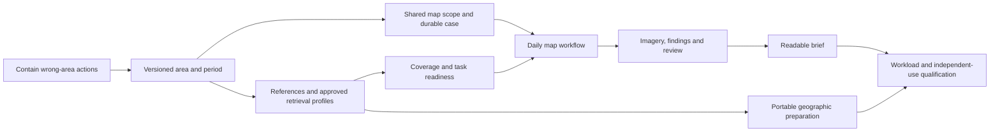

# Map-first implementation plan

**Prepared:** 25 October 2026.  
**Source baseline:** `a6d1d22f34692faea31db58e4a6318c539c3321a`.  
**Governing scope:** [EMAD current scope](../../EMAD_CURRENT_SCOPE.md).  
**Problem statements:** [18-gap report](MAP_FIRST_GAP_REPORT_2026_10_25.md) and [code-backed analysis](MAP_FIRST_GAP_ANALYSIS_2026_10_25.md).  
**Status:** T01–T12 are implemented with scoped verification in the [first-batch report](MAP_FIRST_T01_T03_IMPLEMENTATION_2026_10_25.md), [T04–T06 report](MAP_FIRST_T04_T06_IMPLEMENTATION_2026_10_26.md), [T07–T09 report](MAP_FIRST_T07_T09_IMPLEMENTATION_2026_10_26.md) and [T10–T12 report](MAP_FIRST_T10_T12_IMPLEMENTATION_2026_10_26.md). T13–T24 remain planned. The user reports applying preceding migrations; this work adds 00047–00050 and did not migrate/restart/deploy the shared installation. Shared installation, geographic qualification and independent use retain separate evidence states; the full phase is not qualified.

**Navigation:** [Technical solutions](#2-technical-decisions-and-solutions) · [Migration strategy](#3-data-and-api-change-strategy) · [24 implementation tasks](#4-ordered-implementation-backlog) · [Acceptance scenarios](#5-acceptance-scenarios) · [Qualification budgets](#6-qualification-matrix-and-initial-budgets) · [All 18 gaps mapped](#7-gap-to-delivery-traceability).

**Second-pass audit:** [Plan hardening audit](MAP_FIRST_PLAN_AUDIT_2026_10_25.md) records the omissions found and their resolutions. The backlog now includes atomic requirements, hardening checks and acceptance status. Run `python scripts/ops/check_map_first_plan.py` to check these relationships. Passing that check establishes planning consistency, not implemented behavior or exhaustive correctness.

## 1. Intended result

An analyst can select an area and period, understand actual coverage, investigate a question using retained evidence, acquire supported additional inputs, record findings, hand the case to an independent reviewer, and produce a readable brief with exact citations and a permitted reproducibility bundle. The same workflow works across the Middle East and supported worldwide areas. Missing inputs and access have useful, truthful outcomes.

The map remains the principal working surface. Preserve the compact dock, Systems overview, Go modular domains, PostGIS, MapLibre, immutable evidence, scoped permissions, durable workers and private object storage. Current environment work produces reusable geographic artifacts only. Existing simulation implementation/history stays separately accessible; this plan adds no actors, runtime behavior, sensors, replay, engine selection or exercise milestones.

### Delivery rules

- Correctness containment comes first. A missing or unsupported area must never become Jeddah or another previous selection.
- Resolve shared contracts once and use them across the map, Systems, jobs, investigations, review and output.
- Keep broad discovery separate from bounded acquisition/processing. Global selection does not authorize a global download.
- Preserve source bytes and historical migrations. Add new contracts, metadata and forward migrations without silently rewriting old evidence.
- Deliver small vertical increments, with each task's implementation, installation, functional checks, geographic qualification and user validation recorded separately.
- Numerical budgets and working defaults below are **proposed qualification targets**, not measured results or previously agreed service guarantees. Freeze the qualification profile before running the final gate; record any later revision and its reason.

## 2. Technical decisions and solutions

### D01 — A single versioned area contract

Introduce an `AreaRevision` owned by a new small `internal/areas` domain. Keep `internal/reference` responsible for admitted reference datasets and geographic editions. The new domain owns analyst selections and resolution, not provider ingestion or account partitions.

An area revision contains:

- Identity, revision ID and schema/normalization version; resource scope; display name; kind (`world`, administrative, named study, drawn, viewport or composite).
- Exact WGS84 geometry or a resolvable immutable geometry artifact; hash of its canonical retained representation; source attribution and geographic meaning.
- For administrative selections: source namespace, logical region key, exact edition/feature ID and geographic release ID. Discovery can choose a newer release; saved work continues resolving its exact version.
- Derived bounds **per component**, geodesic area, and declared projection/display restrictions. Bounds are indexes and display aids, never replacements for polygon meaning.
- Parent area revision and explicit subset relationship when narrowing. Preserve the original request geometry and any documented normalization; do not silently simplify the analytical boundary.

`World` is an explicit discovery scope rather than an invented giant local AOI. A place point is a navigation target until the analyst draws/selects an area or deliberately creates a labeled buffer. A viewport becomes an area only through “Use this view”; camera movement otherwise changes presentation.

Resolving an exploratory scope is read-only and can return a validated transient fingerprint. Saving an investigation or submitting a job persists the exact area/period snapshot transactionally. Merely panning, searching or following a link does not create cases or acquisition work.

**Resolution changes:** make exact-ID geographic reads independent of latest-edition discovery. Namespace logical identity by source, and resolve parent/child hierarchy within a declared release. Add an atomic geographic release manifest referencing chunked editions so a partially imported update does not mix new and old subdivision data. Keep old IDs readable subject to current access.

**Geometry edge cases:** normalize a supported date-line-crossing selection into bounded Polygon/MultiPolygon components and retain one parent identity. Broad query counts deduplicate evidence IDs across components. Local raster jobs select one component/subset or an explicit bounded batch; they never use a near-worldwide rectangle across the date line. PostGIS provides split/wrap primitives, but the chosen normalization algorithm must be verified with holes, islands and seam-adjacent geometries. [PostGIS ST_WrapX](https://postgis.net/docs/ST_WrapX.html)

Retain geographic identity and tabular evidence access at high latitudes. Keep the initial map's ±85° display limit explicit, with an actionable explanation; do not claim a polar renderer. A limited display projection must not change retained geographic coordinates or silently discard an area's off-map part.

### D02 — One period contract, several explicitly named clocks

Introduce a `TemporalScope` beside the area contract and combine them into a versioned `ScopeSnapshot`. It records mode, selected observation/acquisition interval, revision-view mode, as-of time, timezone preference and evaluation time.

- **Monitoring:** proposed default is the last 24 hours for event discovery. Actual freshness is source-specific and uses admitted policy/validity, not the 24-hour window. A weather report or moving observation does not become current merely by falling inside that window.
- **Historical study:** explicit fixed interval; retain `latest retained revision`, `known_at` and `effective_at` as separate supported interpretations. Unsupported family/history combinations return a typed unsupported result.
- Resolve rolling time **once per query batch on the server**. A saved monitoring preset can roll; a cited result, investigation checkpoint, submitted job and brief use a fixed evaluated interval and timestamp.
- For imagery, use acquisition time. For observations, use observation/validity time. Retain receipt, provider revision, publication and computation timestamps as distinct fields. Do not reuse “latest” to mean “live.”
- Adopt explicit start-inclusive/end-exclusive intervals in the new scope API. Legacy endpoints retain their existing semantics through a tested adapter; do not silently change old saved queries.
- Historical background imagery is opt-in during monitoring and visibly labeled with acquisition dates and “outside monitoring period” when applicable. It does not contribute to current-observation counts.

The UI shows timezone/offset and year where ambiguity is possible. UTC is always available. The default display timezone comes from the user's preference/browser, rather than assuming every region uses Riyadh time.

**Read consistency:** a fixed interval alone does not freeze the records in it. Introduce a bounded `ReadSnapshot` distinct from `ScopeSnapshot`, containing an authorized query fingerprint, stable result membership/order, exact revision IDs, coverage receipt revisions and an expiry. For initial delivery, materialize paged result manifests under one repeatable-read transaction with current authorization; retain only bounded rows/aggregates with explicit drill-down. Do not keep a database transaction open across HTTP pages. Related family summaries in one batch share this snapshot; independently refreshed layers show their own evaluation times. A timestamp cutoff or maximum sequence alone is insufficient because an earlier-started transaction can commit later. Keep the existing documented `known_at` meaning; do not relabel its publication timestamp as physical commit time. Recheck current access on every page; a changed authorization revision invalidates the snapshot instead of leaking or silently changing totals. Expired cursors explicitly restart the view. Saving/citing work promotes the selected exact references and necessary aggregate manifest to durable evidence; monitoring refresh creates a new snapshot.

### D03 — One client scope owner and explicit pinned work

Create an `AnalystScopeProvider` and typed scope/query adapters. Replace independent operational reads of the `investigation` localStorage preference in `ContextExport`, Systems and capture. Browser preferences retain presentation settings; server cases retain analytical work.

Every map-family request, Systems action, capture form and export receives the same `ScopeSnapshot` or an explicit pinned case revision. Responses echo the resolved scope hash and query evaluation time. Include scope, authorization revision, source filters and temporal semantics in query keys. Accept results only for the active request generation.

Workbench behavior has two explicit modes: follow current map selection, or pinned investigation/draft. “Use current map scope” updates area **and period** after presenting the affected draft fields. Completed jobs, retained evidence and approved outputs never rebind. Changing geography clears invalid scene/pair choices and invalidates export previews.

Pass cancellation signals through all relevant API methods, including geography, scene/capture discovery and artifact previews. Preserve workspace-change abort/cache clearing. A hidden retained workbench may keep a draft, but suspends ordinary polling; a shared job subscription can monitor active work once. TanStack's cancellation behavior requires consuming its signal at the transport boundary. [TanStack Query cancellation](https://tanstack.com/query/latest/docs/framework/react/guides/query-cancellation)

Legacy URL/bookmark import resolves an exact region first, then drawn geometry, then an explicit bbox. Reject conflicting scopes. Invalid or inaccessible saved scope opens a recovery state with no operational submission; it does not reset to the world or another place. Offer deliberate “Start a new view.”

Authorization revisions are server-derived from effective source grants, resource access and case membership; a client cache key is not enforcement. On logout, identity/resource change or an access-denied refresh, cancel subscriptions and clear protected query caches, previews and blob URLs. Unsent draft recovery is opt-in, keyed to the canonical identity and resource, and never displayed to the next signed-in account. Preserve explicitly acknowledged server saves through these transitions.

### D04 — Durable investigations and findings

Add `internal/investigations` with a mutable head pointing to immutable revisions, following the existing review-head pattern. Persist title/question, owner, members, exact scope snapshot, selected evidence references, notes, findings, analysis links, handoff state and output references.

Suggested tables: `investigations`, `investigation_revisions`, `investigation_members`, `investigation_evidence`, `investigation_findings`, `investigation_finding_revisions`, `investigation_review_events` and a required-source dependency projection. Use composite scope-qualified relationships. Notes/findings are authored content; source records remain immutable and are cited by ID, revision and hash where available.

Use expected head revision/ETag checks, returning a conflict without overwriting another edit. Debounced autosave reports saving/saved/conflict/error accurately and flushes on explicit save. Offer device-local unsent draft recovery only when clearly labeled and scoped to the current identity. Server save is the durability guarantee.

A case progresses through draft, active, review requested, changes requested, approved and archived. New edits create a new unapproved revision. Existing source-specific assessments can be linked as evidence; do not force a multisource finding into the existing single-source assessment schema.

**Access design:** membership never grants source permission. Use canonical registered human identity for ownership/contributor/reviewer identity and the current principal's live grants for every access. Add narrowly scoped investigation permissions and transaction-local principal/human identity binding to `db.BindTx`, backed by RLS and service checks. Workers receive explicit job-scoped access.

For the initial release, require access to **all sources contributing to the readable case and retained case history**. This avoids revealing restricted facts through titles, notes, derived maps or approved briefs. Adding a restricted source can make a case unavailable to a previous member; explain that generically without disclosing hidden identifiers. Retain source dependencies when evidence is removed from a later draft. A deliberately sanitized release is a separate future object, not automatic redaction of mixed-source prose.

**Lifecycle contract:** each case revision references exact finding revisions, never mutable finding heads. Authors may draft/edit/submit; an eligible assigned reviewer may request changes or approve the frozen revision; the owner may archive or transfer ownership to an eligible member. Reopening an archive creates a new unapproved revision. Edits during review supersede the pending request. Membership and ownership changes are audited, require live permissions, and do not rewrite authorship or prior approval. Membership alone does not make someone a contributor; content edits do. Removing the last owner requires an explicit eligible successor or administrative recovery, without granting administrators blanket source access. Archival is not evidence deletion. Case mutation, dependency registration and head comparison commit in one transaction so an accepted save cannot point to half-written evidence or findings.

Keep review events, output/job backlinks and current validity notices in append-only relations to a case revision, outside its authored content digest. Recording a brief produced from revision X must not create revision Y and invalidate that same brief automatically. Changes to the question, scope, selected evidence, notes or findings do create a new content revision. A new analysis result is linked operationally first and enters authored content only when deliberately adopted.

### D05 — Configurable regional references

Create versioned region profiles with a human-readable definition, source-backed administrative members, optional explicitly drawn coastal/maritime components, source editions and hashes. A profile influences navigation and reference installation only; it grants no acquisition authority.

Proposed initial working preset: Gulf states, Yemen, Iraq, Iran, the Levant, Egypt, Türkiye and Cyprus, plus explicitly labeled relevant surrounding waters. Resolve members through the installed source's identities and names; preserve that dataset's boundary interpretation. Treat this as a configurable working overview, not a universal or jurisdictional definition of “Middle East.” Worldwide discovery remains available independently.

Parameterize `install_geography.py` and preparation inputs by profile/selected area. Retain country navigation, then expand subdivision/place depth across the configured region and international qualification samples. Use source IDs rather than row offsets for stable place keys. Preserve authoritative aliases as supplied; add normalized search indexes without altering displayed names. Show reference availability, scale/accuracy, edition and an import/request action.

Use chunked imports within existing admission size/feature budgets and activate only a fully validated release manifest. Separate administrative navigation from detailed vector/elevation datasets. Large roads/buildings imports run as bounded worker jobs; no whole-world detailed preload.

### D06 — Several retrieval profiles under the same source identity

Keep provider/product `source_id` stable to preserve evidence identity and deduplication. Add named `retrieval_profiles`, immutable profile revisions pointing to approved `source_admissions`, and per-profile state for cursor, lease, retry, coverage and scheduling. Admission version numbers can remain monotonic per source; each profile head selects its own approved version.

Map each existing source state to a `default` profile with its exact current admission, footprint, checkpoint and quotas. Preserve immutable historical records. Associate historical admissions with that legacy profile without changing their bytes. Old source-only APIs address the default profile explicitly during compatibility; new APIs require profile identity where selection matters.

New profiles require reviewed area/time/product policy and explicit execution authorization for the intended service principal. Record grants to approved profile revisions, or an equivalent bounded versioned execution envelope. Source-level grants alone must not silently acquire authority over new geographic extents. Country selection only reads coverage and available actions.

**Required compatibility refactor:** replace `Artifacts.Admission(sourceID)` as the universal current-policy resolver. Artifact reservation, capture, imagery workers, context preview/freeze and download must resolve the input's original admission/profile plus its currently applicable approved rights and source suspension state. New reservations carry explicit profile/admission identity. Unknown or ambiguous mappings stop processing. No unrelated default profile may supply the rights for an artifact.

Retain evidence uniqueness by source/provider-record/provider-revision. Add retrieval-occurrence links from profile/run to an existing evidence ID, so overlapping profiles preserve successful retrieval/coverage history without duplicating evidence or independent-observation counts. A conflicting body for the same upstream revision is recorded as a provider inconsistency, not overwritten.

### D07 — Durable requests and shared provider budgets

Add durable acquisition requests that reference an investigation/scope, exact profile revision, permitted purpose, interval, bounded parts and a client request key. An analyst can submit within an already approved execution envelope; requests beyond it become an administrative coverage request. No browser request accepts arbitrary provider URLs or credential paths.

A new opaque provider-account quota group in trusted connector configuration binds all profiles/endpoints using the same allowance. Reserve provider-specific request/credit cost atomically before network I/O; apply account-level concurrency/pacing, retry-after and outage backoff in addition to stricter profile limits. Unknown remaining credits are not zero or unlimited. Budget conservative unknown-cost requests according to the approved adapter policy.

Use the existing worker executables and lease patterns. Schedule profiles fairly, with bounded backfill separate from current polling. Expired/replaced leases cannot commit. Resume only the same frozen query/cursor. Keep an intent's idempotency key across retries and lost responses; use a deliberate new key only for a new acquisition. Cancellation stops unstarted parts and prevents stale completion; already retained bytes remain traceable.

Keep active-job and storage-byte budgets. Replace lifetime capture-row ceilings with paginated history and an explicit storage/retention policy. Do not delete retained history to regain queue capacity. When storage is full, pause new acquisition with a recovery action. Preserve stricter provider-specific limits until a separately reviewed policy changes them.

Persist quota reservations before network I/O with attempt identity, cost estimate, reset/window semantics and reconciliation status. If a process dies after sending but before recording the response, treat the charge as potentially spent until provider accounting or conservative expiry permits reconciliation; never refund an unknown call automatically. Idempotency binds resource, operation, authorized requester and canonical frozen input hash: a reused key with different input conflicts. Job creation, intent registration and any outbox/queue row commit atomically. Reserve estimated storage for concurrent work and reconcile actual bytes; reconcile orphan uploads without deleting referenced or still-retained objects. Use bounded retry/backoff with jitter and an operator-visible terminal state. These rules apply to acquisition, brief rendering and environment preparation as well as imagery.

### D08 — Coverage and task readiness as a query result

Add `internal/coverage`, composing authorized profiles, receipts, reference releases, retained evidence, rights, job state and relevant worker/storage checks for a resolved scope. Keep `/platform/readiness` for operational health.

Do not compress independent facts into one green status. Per source/family return:

- Support/access: supported, unsupported, admitted, external prerequisite required; disclose only provider catalog information the user may see.
- Spatial relation: none, partial, full query-footprint overlap or unknown; observation completeness separately remains unknown unless justified.
- Temporal retrieval: requested/evaluated interval, completed and missing windows, latest successful retrieval and evidence time, source freshness.
- Data result: usable retained records, successful empty retrieval, no retrieval, partial retrieval, or unavailable query. Missing metadata is not proof of no observations.
- Task eligibility: can inspect, can request acquisition, needs smaller AOI, needs compatible dates, waiting/failed work, missing review, storage/capacity gate; typed next actions.

Coverage for old evidence uses historical profile receipts, not just today's admitted footprint. Union coverage over profile windows/components without double counting, and qualify approximation or unknown completeness. Permission-filter results before counts; never leak hidden source names, footprints or job IDs through readiness.

Maintain an adapter capability table for USGS, FIRMS, Earth Search, CDSE/STAC, METAR, GDACS and moving feeds, plus reference/DEM imports. Record supported discovery, retention, historical queries, capture/analysis, geometry/time limits, credentials and rights per installed adapter version. This is an inventory of supported operations, not a promise to add historical acquisition to every feed. A completed retrieval receipt records attempted geometry/window, pages, provider truncation, rejected records, publication success and gaps. Exhausted page budgets, rejected normalization or unpublished retained responses cannot establish complete coverage or a successful empty interval. Reference-release availability remains a separate dimension.

### D09 — Useful map behavior and complete catalogs

Keep the current MapLibre canvas and Systems grid. Put area, mode, period and coverage in the main scope strip; route evidence selection, case creation, review and output through consistent actions. A read-only analyst, author and reviewer see role-appropriate starting actions without changing account authority when selecting a country.

Continue PostGIS aggregates and MVT. Use exact scoped counts and explicit aggregate/individual representation, with zoom-to-drill-down and server-paged records. Apply stable cursor pagination to geographic search, scenes, captures, jobs, findings and case lists; bind cursors to scope/query/access revision. All responses distinguish total, returned, representation and continuation. If an exact expensive count is pending, label it pending rather than silently approximating it.

Reference display geometry may be simplified or tile-clipped independently of exact selection geometry. MVT encoding can collapse geometry dimensions; that output must never become authoritative analytical geometry. [PostGIS ST_AsMVTGeom](https://postgis.net/docs/ST_AsMVTGeom.html)

Set query deadlines and response/geometry budgets; preserve the selected scope when offering a narrower view. Use scoped spatial/time indexes and inspect query plans before adding summary tables. Aggregates must retain revision/withdrawal/time and access semantics. Date-line component totals count one evidence record once.

Support Arabic/English aliases, mixed-script text isolation, local/UTC labels, explicit longitude/latitude fields and WGS84 entry first. Other coordinate/datum inputs either use a declared supported conversion with provenance or return an actionable unsupported state. Use existing Arabic font assets. Validate map-label shaping against the installed MapLibre **5.24.0** source; newer documentation describes different RTL behavior. Use a pinned, locally served compatible RTL solution if required, rather than assuming current upstream behavior applies or requiring an unrelated major upgrade. [MapLibre RTL API/version caveat](https://maplibre.org/maplibre-gl-js/docs/API/functions/setRTLTextPlugin/)

Full translation of all legacy screens is not necessary to qualify Arabic place search and mixed-script map work. Extract labels in new/current map workflows so later localization is practical; record English UI support and Arabic-search support separately.

### D10 — Repeatable imagery from discovery through interpretation

Reuse existing scene retention, capture/preparation workers, analysis jobs, masks and exact comparison validation. Add area **and acquisition-time** filtering to scene/capture queries and pass the full scope to capture/compare.

Before submission show the selected investigation area, proposed subset and actual provider scene footprint together. Require a deliberate local rectangle inside the selected area and scene; if a rectangle cannot represent the polygon faithfully, offer a smaller inscribed rectangle or a supported masked-polygon operation, explaining the choice. Keep the current 0.1°-per-side capture bound initially. Never prefill another area when a selected country is too large.

Only offer automatic capture for supported/admitted provider paths; a CDSE catalog result does not imply the Earth Search raster path can capture it. The durable discovery request must retrieve suitable metadata for the requested area/period without developer file preparation. Supported imports remain a secondary explicit action.

The pair chooser first filters by area/subset and acquisition order, then reports existing grid/platform/tile/orbit/baseline/time compatibility rules and clear-pixel quality. Do not silently relax those scientific constraints. Unsupported alignment requires a separately versioned, validated preprocessing method; initial delivery can honestly request another compatible pair. Valid zero-change analysis remains successful and can produce a finding with appropriate limits.

### D11 — Independent review and readable outputs

Findings cite exact immutable evidence, analyses and assessment revisions. A review binds the exact case/finding revision and content manifest. Preserve the existing canonical-human protections; a reviewer/publisher must be distinct from every contributing human author of that reviewed content. Services cannot perform human review. Reviewer edits become a new authored revision that needs another independent reviewer. Account aliases do not establish independence.

Add purpose-specific rights decisions for internal analytical use, citation, included imagery, raw-data distribution and geographic-environment export. Preserve old `AllowSimulationExport` semantics for legacy bundles; do not reinterpret it as general brief-distribution permission. Unknown permission blocks the affected inclusion/export with a specific administrative action. Rights remain source-backed and time/versioned; this plan itself grants none.

Existing artifacts have one `source_id` and an imagery-specific kind/media allowlist. Add a composite derived-output manifest/storage path with all source dependencies and investigation ACL, rather than assigning a multisource brief to an arbitrary source. Reuse private object storage and integrity checks. Check current access, retention and applicable rights before and after external object I/O.

The first readable deliverable is an authenticated HTML brief plus a self-contained downloadable HTML package where included content may be retained/distributed. It contains question, area map, period/mode, coverage, findings, citations, comparisons, uncertainty, omissions, review status and reproduction manifest. Provide print styles for a practical human deliverable. PDF can be added through an isolated renderer using the same frozen manifest; it is not required to invent a new report data model.

Freeze case/evidence/scope, coverage-evaluation timestamp, chart/map inputs, style/renderer versions and allowed assets. Generate retained map/comparison images from those inputs; no hidden live-map screenshot or unreviewed third-party tile fetch during rendering. Render outside synchronous API requests with leases, cancellation and durable attempts. A changed case invalidates the draft's approval eligibility; an existing approved output remains pinned and is labeled superseded when appropriate. Output approval and rights to distribute are separate checks.

**Review/render protocol:** build the frozen content manifest and render a draft first. Reviewers inspect those exact figures, text and omissions. Approval records the content digest, case revision, contributor set and renderer/assets, using an expected-revision transaction. The final approval label is a separate attestation referencing the reviewed digest; adding that label cannot trigger new figure generation. Renderer/input changes create a new unapproved output. Before rendering, committing, approving and serving, recheck dependencies and rights; a race with edits, revocation or expiry stops eligibility. Authorize draft reading separately from approved distribution.

Render source text, names and analyst notes as escaped text or a deliberately restricted markup subset. The downloaded HTML is script-free, contains no active forms or embedded executables, and uses validated links and bounded local assets. The authenticated reader uses the normal protected application shell. Test script/URL injection and path traversal in included asset names; prohibit undeclared renderer network access. Retain visible legends, units, acquisition dates and source attribution in every frozen figure, including mixed-script content.

### D12 — Portable environment preparation only

Parameterize geographic preparation by area revision, supported input source versions, horizontal CRS, input/output vertical datum, local origin and declared size/LOD limits. Reuse Python geospatial tooling and retained-parent storage. Separate fixture-model generation from the geographic preparation entry point.

A durable environment job resolves source coverage/rights, acquires bounded DEM/imagery/vectors, crops/reprojects with explicit transformations, validates, and publishes an immutable geographic package. Retain original bytes, normalized data, source dates/rights, transformation grids and hashes, grid area of use, estimated heights/widths, omissions and processing versions.

For a rectangular raster/grid, record nodata/mask outside the actual selected polygon. Do not represent omitted buildings/roads as complete coverage. Validate vertical conversion applicability with independent control values where available; round-trip success alone is insufficient. Output a neutral manifest plus permitted terrain/vector/imagery files and optional visual GLB, all georeferenced. Environment generation does not require an exercise partition or actor-model worker.

### D13 — Purpose classification and map-only operation

Add append-only content-purpose metadata with `working`, `development`, `acceptance` and `unclassified`, separate from real/synthetic provenance and from review state. Initial classification uses verified installation receipts and known record IDs. Do not infer purpose solely from a name or conclusion string. Ordinary catalogs exclude known development/acceptance items, expose an unclassified-content review action, and do not count unclassified publications as approved working outputs. Support views retain access to original history.

Add explicit local and staging `map`/`historical-full` startup profiles. The map profile requires API/database/object store and enabled public connectors/imagery services, without simulation credentials, runtime descriptors, asset/recording workers or Studio onboarding. Preserve old schema/history and the existing isolation rules. Existing running services are not stopped by a documentation change; the new profile applies on a deliberate subsequent startup.

### D14 — Evidence meaning and later corrections

Carry explicit source/reference fact, provider report, derived indicator and human finding/assessment labels through map inspection, aggregates, cases and briefs. Preserve provider quality separately from analytical confidence, geometry roles separately from display points/buffers, and measured values with units/methods. A thermal report is not automatically a confirmed fire; a derived change indicator is not a human-approved conclusion. Keep conflicting reports visible with their separate provenance instead of silently merging them into certainty.

Track reverse dependencies from evidence revisions to findings, cases and outputs. A provider correction, withdrawal, integrity failure or loss of required inputs creates a current validity notice on affected work. Check that status on open and before review/export; use a bounded repairable projection rather than assuming a missed notification is harmless. Keep the original reviewed content and historical approval event immutable. The current view distinguishes “approved at revision X” from “support changed; reassessment needed”; new distribution requiring current support blocks until reviewed again. A historical export may state the original cutoff and current limitation explicitly under its permitted purpose. Never substitute today's evidence into yesterday's approved figure.

### D15 — Retention and reproducibility boundaries

Preserve immutable identity/provenance and original bytes for their permitted retention, not indefinitely by assertion. Model each dependency's availability, allowed retention and derived-output disposition. Use the strictest applicable inclusion/retention rule unless a source-backed grant expressly permits a longer-lived derived output. Warn about approaching expiry when it affects an active case; never extend a source retention date just because a case cites it.

Reuse the existing artifact deletion states for permitted expiry/deletion and extend them to composite assets. Preserve authorized tombstones, hashes, dependency links and a typed unavailable reason; failed deletion retries safely. Distinguish expired/deleted, access denied, corrupt and temporarily unavailable inputs. Metadata retention itself follows applicable policy. Archived cases and approved outputs may become only partially reproducible; show that limitation and block unsupported re-analysis or regeneration. Restore verification treats a policy-valid tombstone as expected, while a missing unexpired required object is a failure. Do not restore expired bytes into ordinary readable service or overwrite a historical output to conceal loss.

## 3. Data and API change strategy

These are proposed names to make the work concrete. Final migration numbers are allocated in merge order **after 00044**; do not reserve or edit existing migrations.

| Additive migration group | Main records | Compatibility rule |
| --- | --- | --- |
| Area/release | Area identities/revisions, region profiles, geographic release manifests/heads | Old feature IDs and edition bytes remain resolvable; no automatic geometry upgrade |
| Classification | Purpose revisions and current-purpose projection | No mutation of original evidence/conclusion text |
| Investigation | Cases, revisions, members, evidence links, findings, review events, source dependencies | Browser bookmarks import as view presets or explicit new drafts; never invent a question or review |
| Retrieval | Profile heads/revisions/state, execution grants, requests/attempts/occurrences, shared quota ledger | Existing source becomes one exact default profile; no footprint/grant expansion |
| Outputs | Purpose rights decisions, composite output manifests/jobs/reviews | Legacy context bundles retain schema and rights behavior; multisource output has all dependencies |
| Environment | Preparation requests/attempts/manifests and composite artifacts | Old Jeddah packages remain historical and reproducible |
| Read/validity lifecycle | Bounded read snapshots, exact result manifests, reverse dependencies, validity notices and authorized tombstones | Existing time meanings and retained identities remain intact; ephemeral read snapshots confer no durable access |

Proposed API additions, under the current `/api/v1` base:

- Implemented in T04–T06: `POST /analyst-scope/resolve` → validated area/period snapshot and operation capabilities; `GET /areas/revisions/{id}` → exact authorized revision. `POST /analyst-scope/freeze` transactionally persists a scope; existing job/export submissions use the same service inside their own transaction.
- Implemented in T05: `POST /analyst-scope/read` and `GET /analyst-scope/reads/{id}` share materialized membership across family summaries/pages and publish expiry, query fingerprint and evaluation time. Initial bounds: five minutes, 16 active manifests and 64 MiB combined per principal/resource, 8 MiB per manifest, at most 5,000 exact event revisions. These are correctness/storage bounds; later workload qualification remains required.
- Implemented in T04: `GET /geography/regions?id={exactId}` bypasses latest discovery. Release/source/edition selectors and permission-gated `/geography/releases` and `/geography/profiles` pin complete hierarchies. Expanded search/cursor installation remains T08.
- Investigation create/list/read, conditional revision update, evidence attachment, finding revisions, member/handoff and review-action routes under `/investigations`.
- `POST /coverage/query` → per-source/family coverage and task eligibility for a resolved scope; never changes ingestion.
- Profile administration under `/sources/{id}/profiles`; durable `/acquisition-requests` for approved requests and separately recorded requests for expanded coverage.
- Existing imagery endpoints gain explicit scope/profile/admission and time-aware discovery through backward-compatible fields or a versioned request schema. Capture history gains cursor/total metadata.
- `/brief-jobs` and `/environment-preparation-jobs` create frozen durable work; output download resolves the full dependency/rights checks.

For each route, update OpenAPI, generated TypeScript, permission catalogs, route-policy classification, audit redaction and scoped query helpers in the same implementation increment. New public workflows must not obtain an implicit internal-projection bypass. API schema presence alone is not permission provisioning or installed data readiness.

### Upgrade and rollback procedure

1. Record baseline versions/counts/hashes and create a verified paired database/object backup using existing operations tooling. Quiesce all relevant writers, including new render/environment workers and retention cleanup, and verify the quiescence; checking API ports alone does not establish it. Record the maintenance interval and failure recovery procedure.
2. Apply additive migrations, backfill derived mappings/classification from verified records, and verify scoped relationships. Unknown mappings remain explicitly unresolved.
3. Deploy readers compatible with old/new contracts behind feature flags. Keep new writers disabled until compatibility tests pass.
4. For retrieval cutover, drain or fence legacy leases, copy default-profile state transactionally, switch one scheduler owner, then enable new profile writers. Old and new workers must not both own the same source/profile.
5. Validate old IDs, artifacts, context packages, bookmarks and source permissions after restart. Enable each new flow only after its acceptance slice passes.
6. Roll back UI/features and disable new writers while retaining additive schema and immutable history. A rollback binary must either understand the new policy/state or run read-only with affected workers disabled; never fall back to an old source-default rights decision. Use forward fixes or isolated restore rehearsal for data faults, not destructive down migrations. Rehearse the actual previous binary against the migrated schema with new-profile records present, including disabled feature flags, rollback, forward recovery and read-only behavior.

## 4. Ordered implementation backlog

Task details, acceptance scenarios and complete gap traceability follow below. Tasks may be split into small commits/PRs, but a contract migration must keep schema, authorization, API and compatibility behavior together. No task is complete merely because its code compiles.

### T01 — Contain wrong-area submissions immediately

**Gate:** MAP-1, urgent containment before broader refactoring. **Depends on:** none. **Gaps:** 02, 03, 10. **Acceptance:** A02.

Change `ContextExport`, `CaptureWorkbench`, Systems and their callers to use explicit selected/pinned scope inputs. Remove operational Jeddah fallbacks. An absent, unresolved, too-large or unrepresentable selection disables submission and provides a local-subset action. Invalidate incompatible capture scenes/pairs and previews on scope change. Preserve intentionally pinned completed inputs and make their scope visible.

Add regression tests for the recorded Saudi-country → Jeddah-export failure and the large-area → old-capture-AOI failure. This task prevents substitution; complete versioned scope persistence arrives in T04–T07. It can ship before the new data model.

### T02 — Map-only startup and ordinary entry

**Gate:** MAP-0. **Depends on:** none. **Gaps:** 01, 08, 18. **Acceptance:** A01.

Implement D13 in `scripts/ops/local.py`, `apps/emad-local`, `Taskfile.yml`, staging composition and readiness expectations. Audit `internal/app/app.go` and server configuration for profile-specific initialization, background activity and clock/readiness dependencies; the public profile uses wall time and does not activate exercise execution. Provision a map analyst without exercise grants. Do not require simulation token files, binary description or worker startup for the map profile. Keep full historical operation explicitly selectable.

Update Home, default-resource restoration, header navigation and the map chooser so normal startup opens Public Context. Test fresh setup and an upgraded populated installation. A saved exercise resource must not override the selected map profile. Preserve database isolation and historical routes; no data deletion or live worker shutdown belongs to this change.

Include packaging, Docker image entry points, readiness dashboards, `scripts/ops/check_delivery_package.py` and `scripts/ops/paired_backup.py` in the profile inventory. The existing package checker explicitly invokes runtime/asset/recording binaries, so changing startup alone cannot close this task. Qualify the declared Windows local and Linux staging delivery paths, dependencies, pinned fonts/styles/RTL assets and installation/repair instructions; mark any other platform unqualified. Optional external basemap failure must leave selected geometry, evidence lists and source attribution usable with a visible degraded state.

### T03 — Classify content and correct visible counts

**Gate:** MAP-0. **Depends on:** none. **Gaps:** 12, 18. **Acceptance:** A14.

Add purpose metadata and normal/admin catalog filtering under D13. Inventory verified fixture/test IDs from installation receipts and acceptance evidence; backfill classifications without changing source/review bytes. Distinguish catalog revisions, distinct acquisitions, compatible studies and reviewed working outputs in Home/Systems/readiness. Unclassified content remains actionable, not silently promoted or destroyed.

Add the current map-first brief/backlog links to active documentation while preserving historical status records. Later T24 records final qualification rather than reusing historical completion labels.

### T04 — Versioned areas, exact geography and component geometry

**Gate:** MAP-1. **Depends on:** T01. **Gaps:** 02, 03, 04, 07. **Acceptance:** A02, A03, A08.

Implement D01 in the area domain, geographic resolution API, schema and OpenAPI. Split exact retained reads from latest discovery. Add source-qualified logical identity, pinned releases/parents, region-profile manifests and explicit world/point/area distinctions. Implement and verify date-line component normalization and high-latitude display capability results.

Separate canonical selection geometry from display simplification and local processing budgets. Exact area revisions are immutable. Tests cover replacing a geography edition, malformed/conflicting scopes, multipart islands, holes, source restrictions, date-line counts and deliberate subsets.

### T05 — Shared temporal scope and query evaluation

**Gate:** MAP-1. **Depends on:** none. **Gaps:** 03, 06, 15. **Acceptance:** A04, A22.

Implement D02 in a shared Go contract, API validation and TypeScript types/adapters. Preserve known-at/effective-at distinctions and legacy interval compatibility. Define operation/family support explicitly; use one server-evaluated time per monitoring query batch. Include source-validity/freshness metadata without changing observation timestamps.

Test late arrivals, withdrawals, year/timezone boundaries, monitoring preset versus frozen result, and unsupported history. A period must be serializable into investigations and jobs before new consumers are built.

Implement the D02 read-snapshot contract and bounded storage/expiry policy, including publication races. Materialized membership and stable sort order are part of the API contract before cursor consumers are enabled.

### T06 — Connect every user-facing handoff

**Gate:** MAP-1. **Depends on:** T04, T05. **Gaps:** 02, 03, 06, 08. **Acceptance:** A02, A04, A09.

Implement D03 across `PublicAtlasWorkspace`, `WorkbenchContext`, `MapWorkbenches`, `usePublicContext`, Systems, imagery/review/export callers, URL parsing and bookmarks. Use one active scope; support deliberate pinned drafts. Remove obsolete storage reads and invalid-scope fallthrough. Pass request abort signals and scope hashes through the API wrapper.

Browser tests traverse map → Systems → imagery → review/export and back/forward for all area forms and periods, including a scope changed while an old response is delayed. Legacy links either resolve faithfully or show a recovery action.

### T07 — Minimal durable investigation

**Gate:** MAP-1 foundation / MAP-4 early delivery. **Depends on:** T04, T05. **Gaps:** 09, 03, 08. **Acceptance:** A10, A12, A23.

Implement case identity, question, pinned scope, ownership/membership, revision heads and evidence references from D04. Add permission/route policy and transaction-local identity binding with RLS tests. Save, list, reopen and resume from another authorized browser session. Handle revision conflicts and source-access loss without leaking case contents.

Keep this slice small: it establishes actual persisted work before the daily workflow expands. Rich findings, review and briefs follow in T16–T19. Existing bookmarks remain view presets until explicitly turned into a case.

### T08 — Generalized regional reference installation

**Gate:** MAP-2. **Depends on:** T04. **Gaps:** 02, 04, 15. **Acceptance:** A08, A15.

Implement D05 in `install_geography.py`, reference preparation and region-profile configuration. Install the proposed regional depth through source-backed, resumable chunked imports and activate complete releases atomically. Add country/subdivision/place search pagination, aliases, unavailable-depth labels and request/import actions.

Exercise the same machinery on at least four Middle Eastern country selections and three international sample areas. No new country-specific branches in application code. A second source's feature with a similar name/key must not overwrite another source's logical identity.

### T09 — Retrieval-profile model and rights compatibility

**Gate:** MAP-2. **Depends on:** T04, T05. **Gaps:** 05, 13, 14. **Acceptance:** A05, A06, A18.

Implement D06 in public ingestion, source admissions and artifact/imagery/context rights resolution. Split into reviewed increments: additive profile records and exact legacy backfill; explicit profile-aware policy resolver; default-profile API compatibility; fenced scheduler cutover. Keep old and new policy enforcement consistent during rollout.

Enumerate every caller of `Artifacts.Admission` and every source-state join. Tests prove that an artifact from profile A cannot obtain profile B's rights, a disabled source/profile cannot complete new processing, old immutable admissions remain readable, and new profiles receive no execution grant automatically.

### T10 — Durable acquisition scheduling and provider quotas

**Gate:** MAP-2. **Depends on:** T09. **Gaps:** 05, 10, 13, 14. **Acceptance:** A05, A06, A17.

Implement D07 using existing connectors and job/lease patterns. Add explicit acquisition/coverage-request APIs, stable intent keys, profile scheduling, shared provider-account budgets, retrieval occurrence links, cancellation and actionable retry status. Bind all provider requests to trusted connector configuration.

Test two overlapping profiles and two sources sharing a provider account: independent cursors/coverage, deduplicated evidence, shared quota/pacing and no stale-lease commits. Simulate a response lost after successful submission and verify retry returns the same request/job. Add active/storage reservations and uncertain-charge reconciliation here; keep the existing lifetime history cap until T13 installs paging and activates its safe replacement. Ship queue age, quota, attempt, storage and coverage metrics with these workers, before final soak qualification.

### T11 — Area/time coverage and task readiness

**Gate:** MAP-2. **Depends on:** T03, T06, T08, T10. **Gaps:** 05, 13, 06. **Acceptance:** A07, A14.

Implement D08, then expose it in the map scope strip, Systems and relevant acquisition/export actions. Keep operational worker health separately inspectable. Return typed next actions and distinguish support, permission, spatial overlap, retrieval completeness, freshness and data result.

Test empty versus unqueried, partial versus full query footprint, stale versus unavailable, historical receipt versus current admission, gated credentials and healthy workers with unusable input. No UI should infer task readiness from a workspace-wide count.

Implement the adapter capability/receipt matrix in D08. A capped provider response, rejected record or retained-but-unpublished page must not become a complete or successfully empty interval. Correlate UI next actions with authorized durable request IDs and a recorded recovery owner.

### T12 — Monitoring, historical study and useful quiet states

**Gate:** MAP-3. **Depends on:** T05, T06, T11. **Gaps:** 06, 08, 13. **Acceptance:** A04, A07, A21.

Implement the two visible temporal modes and their family-specific adapters in map/event/context/track/imagery queries. Apply acquisition-time filters to study imagery; separately label opt-in background context. Show coverage-aware quiet summaries without claiming factual absence. Keep current-only feeds unavailable when the historical query cannot be answered.

Verify that source failure does not replace successful sibling results with zeros, and that frozen historical results do not refresh into a different meaning. Make the evaluated interval visible in evidence inspection and saved investigation checkpoints.

Preserve the D14 evidence/quality/geometry distinctions in every layer, inspector and aggregate. Connect corrected/withdrawn evidence to a visible validity status without turning a provider report into an independently established fact.

### T13 — Scale, paging and request lifecycle

**Gate:** MAP-3. **Depends on:** T04, T05, T06, T10. **Gaps:** 07, 14. **Acceptance:** A09, A17, A22.

Implement D09 catalog pagination, complete counts/aggregate semantics, query deadlines, scale-dependent reference display and density-aware drill-down. Inspect PostGIS execution plans at the proposed loads. Preserve exact history/revision selection in all aggregate paths.

Suspend hidden-workbench polling, deduplicate job monitoring and abort obsolete reads. Make storage/processing limits actionable. Test more than 300 geography results, 100 capture results and 2,000 map records, plus date-line duplicates, multipart geometry, mixed densities and rapid scope changes. Test acquisition beyond 1,000 retained historical capture rows using isolated data without bypassing active/storage quotas.

Cursor pages, counts and drill-down use D02 read snapshots. Test a late commit, correction and grant change between pages. T10's active/storage guards must be installed before removing the lifetime cap; this dependency is a completion gate, while query profiling can start earlier.

### T14 — Analyst navigation, roles and international usability

**Gate:** MAP-3. **Depends on:** T02, T06, T07, T11. **Gaps:** 08, 15. **Acceptance:** A15, A19 formative.

Refine the existing map/dock/Systems around evidence, investigations, review and outputs. Add role-led entry points and progressively disclosed technical details. Implement explicit timezone/year/coordinate labels, normalized source-backed Arabic/English search and mixed-script rendering. Verify installed-version map-label shaping and locally packaged fonts/assets.

Exercise keyboard/focus, contrast, 320/390px widths, short landscape, zoomed text and screen-reader names for the current workflows. Use separate analyst, reviewer, source administrator and restricted-read accounts; do not rely on the broad development identity. Begin observed user sessions here and feed defects back into the active tasks.

### T15 — Repeatable imagery acquisition and comparison

**Gate:** MAP-4. **Depends on:** T06, T07, T10, T11, T12, T13. **Gaps:** 10, 03, 13. **Acceptance:** A11.

Implement D10 in discovery/capture UI, scene/capture queries and workers. Prefill only supported subsets from the actual scope. Persist request keys, link jobs to case revisions, filter compatible capture pairs and expose quality limitations before analysis. Acquisition remains provider-specific and admission-controlled.

Complete fresh supported acquisitions for an additional Middle Eastern area and an international area. Include cloud/mask rejection, partial scene coverage, alignment mismatch, failed/retried capture, cancellation and valid zero change. A pipeline fixture is useful technical evidence but does not count as fresh real acquisition.

### T16 — Complete case evidence, notes and findings

**Gate:** MAP-4. **Depends on:** T07, T12. **Gaps:** 09, 08, 11. **Acceptance:** A10, A12, A21, A23.

Complete D04 with evidence selection, notes, multisource findings, analysis links, revision comparison and durable autosave/recovery. Resolve exact retained revisions instead of today's latest objects. Derive required-source dependencies for human-written content as well as images and jobs.

Test interrupted save/reopen, two editors, evidence expiry/access revocation and removed-but-historically-cited evidence. Raw evidence is never edited through a case form. A changed scope creates a new case revision and flags incompatible analysis rather than relabeling it.

Implement D04 lifecycle permissions and exact finding revision links, D14 reverse-dependency validity notices, and D15 unavailable-input handling. Test owner departure/transfer, archive/reopen and case access after a required source becomes unavailable; permissions never arise from a recovery action.

### T17 — Handoff and independent review

**Gate:** MAP-4. **Depends on:** T16. **Gaps:** 09, 11, 17. **Acceptance:** A12, A19, A24.

Implement reviewer assignment/inbox, review-requested/changes-requested/approved events and the exact-revision checks in D11. Require live case/source permissions and canonical human separation from all contributors. Add an explicit disagreement/rework loop and preserve prior review history.

Test same-human aliases, service identities, reviewer edits, stale expected revision, revoked grants and a real independent-review session. Automated accounts demonstrate enforcement only; do not label that as independent human validation.

### T18 — Output rights and composite artifact foundations

**Gate:** MAP-4. **Depends on:** T09, T16. **Gaps:** 11, 12, 16. **Acceptance:** A13, A18, A23, A24.

Implement purpose-specific rights decisions and composite output manifests/access under D11. Support authorized references when embedded bytes cannot be included, clearly declaring external dependencies. Reuse private object storage while adding appropriate MIME/kind handling and all-source dependency checks.

Test restricted source mixtures, expired retention, source suspension during I/O, unclassified/development findings, and legacy bundle compatibility. Fail closed on an unknown output permission. Do not fabricate review, redistribute raw assets implicitly or change old `AllowSimulationExport` meaning.

Implement D15 retention/tombstone rules for composite outputs and the D11 review/render attestation contract. Content-purpose reclassification is audited and never converts a development publication into independently reviewed working content; a working successor needs its own permitted review and retains its lineage.

### T19 — Readable, reproducible analyst briefs

**Gate:** MAP-4. **Depends on:** T11, T15, T17, T18. **Gaps:** 11, 10, 09. **Acceptance:** A13, A19, A21, A24.

Build frozen brief manifests, durable rendering, reader view, printable HTML and permitted self-contained download. Include exact citations and retained maps/comparisons, coverage, omissions and review state. Offer the compatible machine-readable evidence bundle alongside it.

Review and export bind the same frozen content. Render changes affecting content/figures require renewed review; approval metadata must remain tied to its reviewed manifest. Test a recipient opening the result without developer assistance, with and without online evidence access, and verify no live fetch silently changes a historical output.

Execute the draft-render → exact-content review → attestation → distribution protocol. Include changed evidence, injected markup, unsafe asset paths, renderer failure and approval/edit races. The review service T17 exposes manifest-bound review operations; this task integrates and qualifies the rendered output.

### T20 — Generalize geographic preparation inputs

**Gate:** MAP-5. **Depends on:** T04, T08, T10, T18. **Gaps:** 16, 02, 04. **Acceptance:** A16.

Refactor geography/environment scripts into area-parameterized operations under D12. Resolve DEM tiles, imagery, permitted vectors, local frame and transformations from frozen inputs. Separate fixture model generation, fixed output names and Jeddah UV/terrain indexing from reusable preparation.

Preserve original source bytes, hashes, source rights/dates and transformation lineage. Verify source coverage and vertical-grid area of use before conversion. Retain the existing Jeddah path as an explicit regression fixture.

### T21 — Durable portable environment package

**Gate:** MAP-5. **Depends on:** T20. **Gaps:** 16, 14. **Acceptance:** A16, A17.

Add environment preparation requests/leases/attempts, bounded resource estimation and validation. Publish georeferenced terrain/vector/imagery artifacts, neutral manifest and optional visual GLB through composite output storage. Validate no-data masks, approximations, source omissions, geometry/LOD/byte budgets and reproducibility.

Prepare another supported area through the product flow without application-code edits. Validate in an independent reader or coordinate-check harness. No actor setup, runtime start or replay is part of this task's test or definition of done.

Before processing, record a qualification profile with output horizontal/vertical tolerances, control-point method and provenance, source resolution/uncertainty, pixels/features/triangles/bytes, temporary disk/RAM limits and maximum attempt duration. Derive tolerances from admitted source accuracy and intended geographic use, not from successful round trips. Reject unsupported CRS/grid area-of-use, missing required DEM tiles or impossible resource estimates before consuming a full job; retained failures explain omissions. A visually plausible mesh alone cannot pass this task.

### T22 — Workload, unattended operation and recovery qualification

**Gate:** MAP-6; harness/budget work begins during earlier tasks. **Depends on:** T02, T10, T13, T15, T19, T21. **Gaps:** 14, 07, 13. **Acceptance:** A09, A17, A18, A22, A23, A24.

Create isolated synthetic load profiles clearly classified as acceptance content. Measure the agreed map/query/render budgets, simultaneous users and multi-profile schedules. Run the unattended wall-clock monitoring profile with queue, memory, storage and freshness telemetry.

Rehearse restart, worker loss, stale leases, storage loss, quota/credential exhaustion, lost responses, source revocation and paired restore. Verify investigations, geographic releases, profile mappings, canonical review identity, briefs and environment dependencies as well as object hashes. Record hardware, dataset size and cold/warm conditions. Fix failed tasks; do not convert failures into looser unlabeled limits.

Extend the actual backup/restore tooling for every new writer/object family and authorized tombstones; rehearse deletion/expiry interruptions and real rollback compatibility. Use metrics introduced with the affected tasks, with correlation IDs and bounded labels that exclude case prose and credentials. Publish per-operation request count, error/timeout rate and p50/p95/p99; an average or a success-only percentile cannot satisfy a latency gate.

### T23 — Independent analyst/reviewer qualification

**Gate:** MAP-6, with early sessions after T14. **Depends on:** T14, T19, T21, T22. **Gaps:** 17, 15, 08, 11. **Acceptance:** A19, A20.

Observe target users on the geographic/state matrix below. Compare completion, assistance and result usefulness with their present workflow. Require correct area/period and coverage/uncertainty explanations. Include a reviewer distinct from case contributors.

Record observed task outcomes, corrections and retest evidence. Participant availability is an external gate; automation cannot substitute for it. Early formative sessions can proceed before every late task is finished, but the final qualification uses the complete declared release candidate.

### T24 — Active product documentation and release evidence

**Gate:** MAP-0 initial direction / MAP-6 final closure. **Depends on:** T03, T22, T23. **Gaps:** 18, 01, 12, 17. **Acceptance:** A20.

Reconcile README, PRODUCT, current scope links, operations and the active backlog around the map-first phase. Clearly label old plans as historical. Document supported map/coordinate/time behavior, installed geographic/source profiles, known gates and the map-only startup path.

Publish a release ledger linking each gap/task to exact source revision, installation profile and evidence. Distinguish implementation, installation, functional verification, geographic coverage and user validation. All P0 checks and mandatory acceptance scenarios must pass before claiming the phase delivered. Deferred simulation remains a separate later design decision.

### Execution order and useful delivery checkpoints

1. **Immediate correction:** T01, then T02/T03. Wrong-area actions stop; the normal product and its counts follow the corrected phase.
2. **Trustworthy scope and saved work:** T04/T05 → T06/T07. This is the first complete contract checkpoint and enables real formative feedback.
3. **Geographic/source expansion:** T08 and T09 → T10 → T11. References expand without changing ingestion authority; several profiles operate independently.
4. **Daily map workflow:** T12/T13/T14. Monitoring/historical meaning, scalable discovery, role-focused navigation and international input are coherent.
5. **Complete analyst outcome:** T15/T16 → T17/T18 → T19. Reopenable investigation, repeatable imagery, independent review and readable brief work together.
6. **Environment preparation:** T20 → T21, once required inputs and output-rights contracts exist. It may overlap late reporting work, respecting dependencies.
7. **Qualification:** T22 → final T23 → T24. Formative T23 sessions still start after T14; closing user sessions use the operationally qualified release candidate. The earlier gates are closed by measured outcomes, not another feature list.

T05, reference preparation, test harness design and early user sessions can progress when their dependencies permit. This ordering is a dependency plan, not an instruction to launch parallel agents or to implement all tasks in one change.



The map-only startup and content-purpose work apply across the chain. Rights and access checks remain attached to every dependent operation.

## 5. Acceptance scenarios

These scenario IDs are the stable references used by tasks and the backlog ledger. Add tests where they exercise meaningful behavior; do not use snapshot counts or tests mirroring implementation as a substitute for workflow proof.

### A01 — Independent map startup

Fresh and upgraded map profiles start without runtime/recording/asset executables or simulation grants. An ordinary analyst enters Public Context and completes discovery/save. Missing optional simulation facilities do not mark the map task unavailable. Historical facilities still require their original explicit access.

### A02 — Area integrity across every handoff

Country, subdivision, named study, drawn polygon, viewport and reopened investigation preserve exact area meaning through map, Systems, capture, analysis, review and export. A too-large country demands deliberate narrowing. An existing pinned draft stays labeled with its own scope. Missing geometry and unsupported shapes cannot submit another place. Inspect request bodies and retained output manifests, not only visible labels.

### A03 — Immutable geography across updates

Save a case against edition A, install release B, and reopen A with identical retained geometry/hash. Latest discovery may show B. Check old parent hierarchy, partially staged releases, mixed providers, deleted/renamed upstream places and access revocation. No current release silently rewrites a historical output.

### A04 — Time interpretation

Use current monitoring, fixed historical intervals, known-at and effective-at with late/corrected/withdrawn reports. Test rolling preset evaluation, frozen checkpoints, midnight/year boundaries and different user timezones. A historical capture outside monitoring time is omitted or explicitly background context. Unsupported historical feeds show unsupported, not a present-day reconstruction.

### A05 — Selection does not change authority

Switch countries and create study areas without any admission/grant mutation. An approved bounded acquisition executes; an out-of-envelope request enters the coverage-request workflow. An unapproved profile/revision cannot be claimed by an existing source-granted worker. A normal analyst is not prompted for raw token-file paths.

### A06 — Multi-profile retrieval without corruption

Run overlapping profiles concurrently: independent cursors, leases, periods and coverage; one retained provider revision where identities match; occurrence history for both runs. Exhaust shared account quota and verify all affected requests pace fairly. Retry after response loss using the same intent key. A stale lease, changed profile or rights suspension cannot publish new completion.

### A07 — Coverage, emptiness and readiness

Demonstrate outside footprint, partial/unknown coverage, missing retrieval, successful zero-result retrieval, stale data, missing credentials, denied access, provider failure and healthy workers with no compatible inputs. Every case has a truthful summary and supported next action. No result asserts factual absence merely because the retained count is zero. Forbidden source details do not leak through totals or readiness.

### A08 — Reference depth and worldwide geometry

Find subdivisions/places in several Middle Eastern countries and international areas via the same importer/search. Test Arabic/English aliases, point-only places, coastal/maritime study areas, cross-border selection, date-line components and explicit high-latitude display restrictions. Imports resume and activate atomically; detail not installed remains labeled and requestable.

### A09 — Scale and stale-response control

Use catalog sizes above former result caps and dense map queries above the aggregate threshold. All totals/subsets/cursors have accurate meanings. Verify component deduplication, aggregate drill-down and detail retrieval. Change area/period rapidly under delayed responses: obsolete data cannot replace the active view, server work cancels within budget, and hidden workbenches do not accumulate polling.

### A10 — Durable case and conflict behavior

Save a question, scope, evidence, note and analysis link; restart and reopen through another authorized device/session. Test interrupted saves, visible unsent drafts, two simultaneous editors and expected-revision conflicts. No autosave claims success before persistence. Editing a case does not change immutable evidence or relabel prior jobs.

### A11 — Fresh imagery and honest analytical outcomes

From the selected case, discover admitted scene metadata, choose a valid local subset, acquire real windows, inspect masks, select a compatible pair and retain analysis. Repeat on an additional Middle Eastern and an international AOI where supported data exist. Exercise cloud/coverage/alignment failures, expired access, interruption, retry, deduplication, cancellation and valid zero change. Count distinct acquisition dates separately from capture attempts and catalog revisions.

### A12 — Case access and independent review

Test ownership/membership plus effective source grants through API and non-owner database role. Include direct joins, pooled-connection reuse, service workers, a member losing a source grant and restricted case titles/notes. Reviewer assignment never grants source access. Same-human aliases, contributing authors and service identities cannot independently approve; new authored revisions invalidate approval eligibility. Real independent review is separately recorded under A19.

### A13 — Useful brief and controlled output

Generate/read a question-led brief with area/period, coverage, maps/comparison, exact citations, uncertainty and review state. Verify manifests/asset hashes and current dependency access before download. Test denied byte inclusion with permitted references, no external dependency masquerading as offline-complete output, legacy bundles, changed case revisions and expired rights. Export authority is checked before distribution; downloaded copies are not claimed to support remote revocation.

### A14 — Development content retains its meaning

Known acceptance/development records are excluded from ordinary working counts/defaults. Real source bytes used by tests remain identified as real, while their test publications remain test publications. Unclassified records are visible through an explicit review path. Administrators can inspect retained history, with original IDs and immutable content intact.

### A15 — International and role-focused interaction

Use separate analyst, reviewer, source administrator and restricted-read accounts. Verify source-backed Arabic/English aliases, mixed-script labels/notes, correct map shaping, visible timezone/year, explicit coordinate order and supported datum/units. Complete core tasks with keyboard and at 320px/390px and short-landscape sizes; verify focus restoration, text zoom, contrast and readable errors. Record English application-language support separately from Arabic place search and content support.

### A16 — Portable geographic preparation

Prepare an additional supported area using the same public workflow. Verify CRS/frame/origin, vertical datum/grid applicability, independent control values, parent hashes, source dates/rights, nodata, estimated properties, omitted geometry, budgets and reconstruction. Read the output independently of Studio. Actors, synthetic sensing and runtime execution are absent from the preparation journey and acceptance criteria.

### A17 — Faults, capacity and unattended use

Run the declared wall-clock profile and capture request/job/worker/coverage telemetry. Rehearse API/worker restart, abandoned lease, object store failure, provider backoff, credential expiry, full storage quota and lost responses. Test history growth beyond legacy caps without relaxing active/storage/provider limits. Recovery preserves exact scope, attempts and evidence meaning, and stale workers cannot commit.

### A18 — Upgrade, restore and access preservation

Upgrade an isolated populated installation through all forward migrations. Confirm old source/evidence/scene/capture/package/area IDs and still-permitted original bytes are unchanged; legacy admission mappings remain exact. Restore the paired database/object backup into isolated services and validate every required object/dependency, including policy-valid tombstones under D15. Reproduce an analysis with retained permitted inputs, read a case/brief and validate member/source restrictions after restore. Rehearse the actual rollback binary and forward recovery with new profile records present. A successful storage probe alone does not satisfy this check.

### A19 — Observed independent usefulness

At least three target analysts and one independent reviewer are the proposed initial sample, with the reviewer separate from the case contributors. Start formative sessions during T14; use the final release candidate for the closing sessions. Ask users to discover, explain coverage/time, save/resume, analyze, hand off and read a brief, including no-data/gated cases. Record assistance and wrong interpretations rather than coaching them through silently.

Proposed exit: no wrong-area or wrong-period outcomes; all participants correctly explain coverage versus absence and result/review status; at least 80% of assigned core task attempts complete without developer assistance, with counts and failures reported. Every critical failed journey is repaired and retested. This small sample establishes a bounded usability result, not statistical proof for all users.

### A20 — Honest release ledger

Every task and gap has links to its implementation revision, installed profile, functional evidence, geographic samples and user-validation status. P0 failures block release. An external prerequisite can remain documented as gated, but cannot be labeled as a successful live capability. All mandatory journeys in the declared release profile pass. Future simulation design is explicitly outside the next automatic task sequence.

### A21 — Evidence semantics and changed support

Carry a provider report, source/reference fact, derived indicator and human assessment from map to brief with their distinct quality/confidence and geometry meanings. Correct, withdraw or invalidate cited evidence after a finding is approved. The exact historical content stays pinned; current views show the support-change notice and reassessment action. New current-purpose approval/distribution cannot silently proceed on invalidated support. Test conflicting reports and a missed/rebuilt dependency projection.

### A22 — Stable reads under concurrent publication

Page a result while another transaction publishes, corrects or withdraws matching evidence, including a transaction begun before the read snapshot but committed afterward. Counts, order and exact revisions stay consistent within the snapshot; monitoring refresh deliberately creates a new result. Test concurrent grant changes, cursor tampering/wrong scope, snapshot expiry and resource limits. No long-lived database transaction or unrestricted result cache is required for pagination.

### A23 — Lifecycle, retention and lost access

Archive/reopen, transfer ownership, remove a member, switch accounts with an unsent draft, and expire a referenced input while a job is running. Case revisions retain exact finding versions; protected content never appears under the next account. Exercise interrupted artifact deletion and restore of permitted tombstones. Missing unexpired dependencies fail validation; expired dependencies show unavailable/partial-reproduction status and never receive an invented retention extension. Repeat for composite briefs and environment packages.

### A24 — Review/render and durable publication races

Render a draft, edit the case or change the renderer, and attempt approval of the previous manifest. Only the exact inspected digest can receive an attestation; altered content needs a new review. Race approval, rights revocation, worker cancellation and object upload completion. A crash/lost response creates neither a second intent nor a published object without its database record. Include script/URL injection and unsafe embedded paths; a self-contained brief performs no undeclared fetch and executes no included source text.

Recording output backlinks, review events or validity notices does not mutate the reviewed authored revision or invalidate itself; adopting new evidence or editing a finding does.

## 6. Qualification matrix and initial budgets

### Geographic and state sample

- **Regional detail:** proposed Saudi Arabia, UAE, Jordan and Egypt, including at least one supported subdivision and place in each. These are test samples, not the complete regional definition.
- **International:** proposed France, Japan and Brazil, spanning different regions and geometry/data conditions. Include a supported local acquisition outside the Middle East.
- **Cross-border/maritime:** one regional view spanning multiple administrative areas and one coastal/water study polygon; record actual provider coverage and source boundary meanings.
- **Geometry extremes:** a date-line-crossing study and a high-latitude selection; verify the explicit supported behavior instead of pretending the initial map projection is universal.
- **Selection forms:** country, subdivision, named study, drawn polygon, viewport and restored investigation, plus a point-only place that requires explicit area selection.
- **Evidence states:** current, historical, corrected/late, withdrawn, successful empty, unobserved, partial, stale, missing credentials, denied access and processing failure.
- **Real workflows:** a fresh imagery study in an additional Middle Eastern AOI and an international AOI; one new environment package outside the prepared fixture; independent case handoff and brief reading.

Choose acquisition dates after checking actual admitted catalog/quality; do not promise a fixed clear pair before discovery. Unsupported inputs are legitimate negative tests, but they cannot replace all required successful real journeys. A restricted optional feed can remain gated if the declared product and acceptance claims say so explicitly.

### Proposed workload profile v1

Freeze exact fixtures, hardware, software versions, provider budgets and test duration before measurement. The following is the starting qualification proposal:

- **Read load:** 100,000 retained report revisions, 50,000 detailed reference features with realistic polygon complexity, 10,000 weather/moving records and 1,000 catalog/capture-history entries distributed over at least ten areas. Use isolated acceptance data with varied spatial density and revision history; do not inject synthetic public facts into ordinary working catalogs.
- **Concurrency:** five simultaneous analyst sessions plus ten scheduled retrieval profiles; retain the initial maximum of four active raster captures. Respect stricter provider limits even when that reduces throughput.
- **Latency:** scoped search/coverage p95 ≤1 second; map family/tile requests p95 ≤2 seconds; first useful map after selection ≤3 seconds on the recorded local qualification network. Record cold and warm results separately and distinguish provider acquisition time from interactive query latency.
- **Responsiveness:** ordinary controls respond within 100 ms on the recorded browser/hardware; no obsolete query results displayed after a scope change. Cancel client fetches promptly and bound canceled server reads within 5 seconds. Prevent hidden workbench history from increasing active poll counts.
- **Payloads:** initial detailed GeoJSON response target ≤2 MiB, individual reference tile target ≤512 KiB; enforce totals/representation semantics when switching to aggregates. Existing local raster size/geometry limits remain until measured expansion is justified.
- **Durability:** zero acknowledged case edits lost; no duplicate job for the same intent; no stale-lease completion; all restored required and still-permitted objects hash-verified, with policy-valid tombstones explicitly reconciled.
- **Soak:** 24 actual wall-clock hours with monitoring/retries and at least one planned worker restart. Capture queue delay, provider freshness, memory/storage growth, failures and recovery. A simulated or virtual hour is not equivalent.
- **Recovery:** worker retry/lease recovery within 5 minutes under the declared profile; object/provider recovery produces visible state transitions without data substitution. Measure RTO/RPO from the backup procedure instead of inventing a universal guarantee; retain the actual last consistent backup time.

These values may be revised after baseline measurement and explicit review of tradeoffs. Publish both the original and revised profiles; never mark an unmet target passed by changing its definition after the run.

## 7. Gap-to-delivery traceability

| Gap | Priority | Main implementation tasks | Closure evidence |
| --- | --- | --- | --- |
| GAP-01 Simulation scope drift | P0 | T02, T24 | A01, A20 |
| GAP-02 Hardcoded geography | P0 | T01, T04, T06, T08, T20 | A02, A08, A16 |
| GAP-03 Incorrect area handoff | P0 | T01, T04–T07, T15 | A02, A03, A04, A10, A22 |
| GAP-04 Uneven reference depth | P1 | T04, T08, T20 | A03, A08, A16 |
| GAP-05 Availability versus coverage | P0 | T09–T11 | A05, A06, A07 |
| GAP-06 Monitoring versus history | P0 | T05, T06, T11, T12 | A04, A07, A21, A22 |
| GAP-07 Regional/world scale | P1 | T04, T13, T22 | A08, A09, A17, A22 |
| GAP-08 Competing navigation | P1 | T02, T06, T07, T12, T14, T16, T23 | A02, A10, A15, A19 |
| GAP-09 Durable investigation | P1 | T07, T16, T17, T19 | A10, A12, A13, A19, A21, A23, A24 |
| GAP-10 Repeatable imagery | P1 | T01, T10, T15, T19 | A02, A06, A11, A13 |
| GAP-11 Analyst brief/output | P1 | T16–T19, T23 | A12, A13, A19, A21, A23, A24 |
| GAP-12 Development content | P1 | T03, T18, T24 | A14, A20 |
| GAP-13 Task readiness | P1 | T09–T12, T15, T22 | A06, A07, A17 |
| GAP-14 Workloads/unattended operation | P1 | T09, T10, T13, T21, T22 | A09, A17, A18, A22, A23, A24 |
| GAP-15 International/role usability | P1 | T05, T08, T14, T23 | A04, A08, A15, A19 |
| GAP-16 Portable environment preparation | P2 | T18, T20, T21 | A13, A16, A18, A23 |
| GAP-17 Independent usefulness | P1 | T17, T23, T24 | A19, A20 |
| GAP-18 Documentation/approval state | P0 | T02, T03, T24 | A01, A14, A20 |

## 8. Risks and bounded decisions

**Highest implementation risk: profile-aware rights and scheduler cutover.** Source state currently has one active admission and artifact consumers depend on it. Implement T09 before enabling new profiles, exhaustively inventory policy consumers, and fence old workers during cutover. A UI-only profile selector would be incomplete.

**Highest correctness risk: partial scope migration.** Moving only export to the new area model leaves capture, Systems, bookmarks or pinned drafts inconsistent. T06 must close the full handoff matrix. Geometry and time are server-validated, not trusted merely because TypeScript types match.

**Highest access risk: multisource authored content.** Case prose and rendered images can reveal a restricted source even if individual evidence APIs deny it. Enforce whole-case/output dependency access initially, with explicit worker job authorization. Reuse canonical review identity and prevent reviewer edits from retaining independence.

**Geographic expansion risk: mixed releases and assumed fidelity.** Admit complete reference releases, retain original editions and source boundary meanings, and treat generalized reference polygons as qualified references. Preparing a second DEM region also requires suitable transformation grids and controls, not just a new bbox.

**Operational risk: larger history exhausts old finite budgets.** Replace lifetime-row ceilings with pagination and explicit storage/retention policy, keeping admission limits and exact history. Add bytes/queue/age diagnostics before increasing workloads; full disks should stop new work predictably.

**Scope risk: solving every gap by adding a new platform.** Reuse existing modules, workers, database, storage and map. Introduce only the domain records needed for scopes, cases, profiles and outputs. A generic workflow engine, new simulation architecture or unrelated mapping-library major upgrade is not a prerequisite.

### Defaults adopted for planning

The plan recommends an English initial interface with Arabic/English place search and mixed-script correctness; explicit local/UTC display; 24-hour event monitoring with source-specific freshness; server-persisted cases; independent case-revision review; readable HTML/print output first; and the versioned working regional preset described in D05. These are concrete starting choices, not hidden dependencies on a future planning exercise.

Before qualification, record the target analysts/reviewer, accepted task list, exact installed source profiles and final workload profile. Provider credentials/terms, additional coverage approvals and actual human participation are external prerequisites for their dependent acceptance cases. Continue independent implementation/testing while those are unavailable, but leave the corresponding live/usefulness results unqualified. Do not create placeholder operational evidence or mark them complete.

## 9. Verification and evidence procedure

Each implementation task should attach its change-specific proof plus the applicable checks already supported by [Taskfile](../../Taskfile.yml):

- Changed Go packages and focused integration cases, then the existing assembled PostGIS/S3 integration gate when their contracts are affected.
- TypeScript typecheck/production build, regenerated OpenAPI client reproducibility, permission/route-policy consistency and relevant real-backend browser journeys.
- Migration-on-populated-data, RLS/source/case access and original-byte preservation for schema changes. Existing canonical identity and public/exercise isolation regressions continue to apply.
- Keyboard/narrow-layout and scope/time browser checks for affected user actions. Add failure or race cases where they address an actual behavior risk.
- Source installation/real-acquisition, output rendering, environment verification and independent sessions as separately dated evidence; fixtures cannot satisfy these by themselves.

Store sanitized evidence under `docs/implementation/evidence/map-first/` with task/scenario ID, commit/build, configuration/profile hash, source/area versions, execution date, hardware where relevant, expected/actual result and limitations. Keep tokens, private provider responses and restricted evidence out of committed test reports. Link permitted artifacts instead of copying confidential content into diagnostics.

Maintain the [machine-readable backlog](MAP_FIRST_BACKLOG_2026_10_25.json) alongside this plan. Its initial task status is `PLANNED`; each task has separate implementation, installation, functional, geographic and user-validation evidence arrays. Populate those with actual results, never speculative percentages.

**Planning-pass verification:** source/API/schema inspection and checks of task dependencies, gap coverage, acceptance IDs and document links. No new application tests, migrations, data installation, provider activation or user sessions were performed merely to prepare this plan.

## 10. Closure rules and maintained planning harness

The [audit](MAP_FIRST_PLAN_AUDIT_2026_10_25.md) and backlog's atomic requirements make coverage reviewable below the gap-heading level. The validator checks IDs, task/scenario mappings, reciprocal gap coverage, dependency ordering/cycles, source-document fingerprints, and local links. Its failure-injection mode checks that omitted coverage, cycles, mismatches and unsupported completion claims are actually rejected. Neither mode verifies that the proposed algorithms work; that remains the implementation and acceptance work.

```powershell
python scripts/ops/check_map_first_plan.py
python scripts/ops/check_map_first_plan.py --self-test
```

Use these closure rules throughout execution:

1. Establish an accountable implementation owner and evidence reviewer for each active task, and the named participants/operators for external prerequisites. The ledger records role requirements now; do not fabricate named assignees or dates. Record unresolved prerequisites as `NOT_CONFIRMED` or `BLOCKED`, not completed capabilities.
2. Early gates close their applicable scenario assertions only. For example, MAP-0 proves startup/discovery in A01; saving a case additionally needs T07. T17 can finish its manifest-bound review service before T19 supplies rendered briefs. Final A01/A24 results require the integrated journey. Partial task evidence must state the exact assertion it exercises.
3. Final release qualification uses one immutable candidate identity: commit/build, migrations, configuration, source/profile/area versions, renderer/assets, permission model and workload profile. Evidence records expected/actual outcomes, run time, environment and applicable assertions. Implementation, installation, functional, geographic and independent-user proof remain separate. Explicitly justified `NOT_APPLICABLE` is allowed for a task/evidence dimension, never for a mandatory end-to-end scenario.
4. All 24 acceptance scenarios are mandatory at phase closure, including their required successful real journeys. An optional feed can remain gated; it cannot replace required acquisitions, independent people or an environment package. If one is blocked, release a clearly scoped increment if useful, but do not close its gap or claim all 18 solved.
5. Wrong area/period, access leaks, lost acknowledged saves, invalid review, broken provenance or mandatory recovery failures block closure. Numeric targets, geographic/environment tolerances and participant tasks are frozen before qualification. Report failures, timeouts and sample sizes alongside latency results; mark flaky or unavailable checks unresolved.
6. Record the preflight baseline, then T22 operational qualification and final T23 user qualification against that candidate. A subsequent fix invalidates affected evidence: rerun impacted functional/geographic/user assertions, and repeat the soak when scheduling, resource use, persistence or recovery changed. Unrelated evidence can be carried forward only with a recorded impact rationale. Dates alone do not establish that evidence describes the release candidate.
7. Keep an operator runbook for quota/credential gates, storage exhaustion, expired dependencies, stalled jobs, backup quiescence and rollback. Each diagnostic links a recovery action to an authorized role. Metrics are shipped with the related feature, rather than added only for T22.

No planning-only audit can establish that nothing remains undiscovered. This revision resolves the identified design omissions and provides explicit tests and closure rules for the remaining implementation uncertainty.
